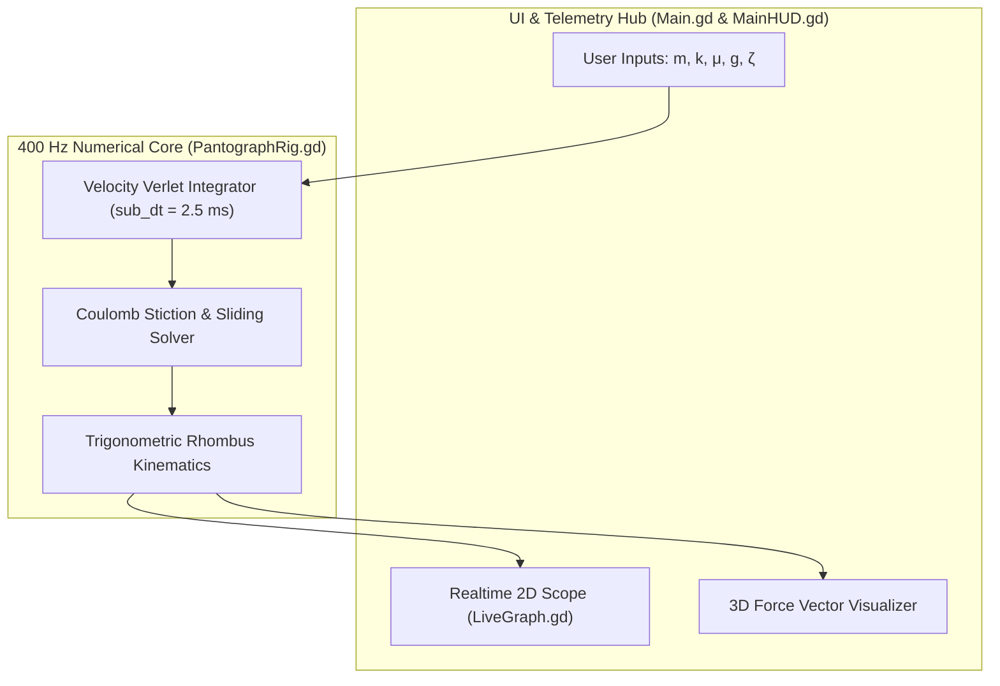

# Sim-to-Real Verification of the Golden Rule of Mechanics
### Experimental Multi-Stage Pantograph Kinematics, Coulomb Joint Dynamics, and 400 Hz Symplectic Simulation

[](https://karenghardashyan.github.io/scissor-mechanism-golden-rule/)
[-34C759?style=flat-square&logo=windows&logoColor=white)](build/ScissorPantograph_Windows_x64.zip)
[](https://godotengine.org)
[](cad/)
[](slicer_profiles/)
[](LICENSE)

---

> [▶ Launch Interactive Browser Simulation](https://karenghardashyan.github.io/scissor-mechanism-golden-rule/)  
> *Runs in-browser via WebAssembly. Features real-time parameter sweeps ($m$, $k$, $\mu$, $g$), vector decomposition, dynamic vibration damping, and live experimental data overlays.*

> [Side-by-Side Video: Physical Rig vs. Digital Twin (Coming Soon)]  
> *Demonstrating empirical bench oscillations against the 400 Hz numerical integrator.*


---

## 1. Project Trajectory & Overview

I initiated this research in 10th grade (Spring 2024) at the A. Shahinyan Special Phys-Math School under Yerevan State University. The original goal was straightforward: build an empirical test apparatus to verify the classical **Golden Rule of Mechanics** (*Goldene Regel der Mechanik*) and the **Principle of Virtual Work** using multi-stage 3D-printed linkages. 

In high school physics laboratories, mechanical advantage is almost exclusively demonstrated using static levers or pulleys on a chalkboard. When I constructed physical multi-stage pantographs, I quickly discovered that physical multi-body linkages depart significantly from simple textbook equations. FDM 3D-printed joints introduce non-linear Coulomb friction, axial pin clearance backlash, structural self-weight sag, and out-of-plane torsional buckling. Furthermore, under static load, friction creates a deadband envelope where the linkage rests at multiple valid heights for the exact same mass.

In 12th grade (2025–2026), I expanded this experimental project into a full **Sim-to-Real research pipeline**. I developed an interactive 3D digital twin in Godot 4.5 using a custom 400 Hz Velocity Verlet numerical integrator. Rather than relying on game-engine physics approximations, I wrote a dedicated solver that incorporates:
- Exact joint force vector decomposition ($\vec{R}_{\text{upper}}$, $\vec{R}_{\text{down}}$),
- Load-dependent Coulomb stiction thresholds ($F_{s,\max} = \mu \cdot R_{\text{down}}$),
- Distributed structural link mass compensation,
- Quasistatic deadband envelopes matching my empirical bench data.

```text
[ Physical Workflow ]
SolidWorks CAD -> Ultimaker Cura Slicing -> FDM 3D Printing -> Test Stand Experiments -> Desmos Regression
                                                                                                  |
                                                                                (Sim-to-Real Discrepancies)
                                                                                                  v
[ Digital Twin Pipeline ]
Custom 400 Hz Velocity Verlet Solver <- Coulomb Stiction Solver <- Joint Equilibrium Decompositions (Godot 4.5)
```

---

## 2. Theoretical Framework & Non-Ideal Mechanics

### Principle of Virtual Work and Kinematic Amplification

Consider an ideal $n$-stage planar scissor pantograph suspended vertically from a fixed ceiling pivot. An upper extension spring with stiffness $k$ is mounted across the first stage, providing restoring tension $T$ over vertical stage extension $H$. A mass $m$ is suspended from the terminal pivot, undergoing total vertical stroke $L$.

For a frictionless linkage in static equilibrium, the net virtual work performed during an infinitesimal virtual displacement $\delta H$ must equal zero:

$$
\delta W = \delta W_{\text{in}} - \delta W_{\text{out}} = 0
$$

$$
T \cdot \delta H = P_{\text{eff}} \cdot \delta L
$$

Where $P_{\text{eff}}$ is the effective gravitational load. Defining the kinematic transmission ratio $\lambda \equiv \frac{\delta L}{\delta H}$:

$$
\lambda = \frac{\delta L}{\delta H} = n \implies T_{\text{ideal}} = n \cdot P_{\text{eff}}
$$

For a linear Hookean spring with rest height $H_0$, spring elongation is $\Delta H = H - H_0 = \frac{T}{k}$. Substituting $\lambda$:

$$
\Delta L = n \cdot \Delta H = \frac{n^2 \cdot P_{\text{eff}}}{k}
$$

The mechanism acts as a displacement multiplier ($\lambda = n$), but requires an $n$-fold increase in spring tension to support the same external payload.

---

### Effective Load Formulation (Compensating Structural Self-Weight)

In theoretical derivations, links are frequently assumed massless. In my physical prototype, the PLA scissor arms ($m_{\text{link}} \approx 0.05\text{ kg}$ per stage) contributed measurable self-weight that caused baseline sag:

$$
P_{\text{eff}} = \left(m + m_{\text{struct}}\right) g = \left(m + \frac{n}{2} m_{\text{link}}\right) g
$$

For Rig C ($1:2:3$ progressive scale), where link lengths scale as $\{1\ell, 2\ell, 3\ell\}$:

$$
P_{\text{eff}} = (m + 3.0 m_{\text{link}}) g
$$

---

### Joint Statics and Vector Resolution

At each lateral joint (knee pivot), two links meet at angle $\theta$ relative to the horizontal plane. The vertical load transmitted through stage $s$ is partitioned equally between the left and right scissor arms:

$$
F_{y,\text{down}} = \frac{P_{\text{stage, down}}}{2}
$$

$$
F_{x,\text{down}} = \frac{F_{y,\text{down}}}{\tan\theta}, \qquad R_{\text{down}} = \frac{F_{y,\text{down}}}{\sin\theta}
$$

As the linkage flattens ($\theta \to 0^\circ$), $\sin\theta \to 0$, causing an asymptotic surge in internal axial load ($R \propto 1/\sin\theta$). The joint pin must transfer these large axial reactions without yielding in shear or binding under friction.

---

### Coulomb Stiction Deadband Theory

In physical revolute joints fastened with bolts, friction is governed by Coulomb dry friction:

$$
F_{s,\max} = \mu \cdot N
$$

The normal force $N$ pressing the bolt shank radially against the inside wall of the linkage hole equals the internal transmitted load $R_{\text{down}}$:

$$
N \approx R_{\text{down}} = \frac{P_{\text{stage, down}}}{2 \sin\theta}
$$

Consequently, **the maximum static holding capacity $F_{s,\max}$ scales proportionally with suspended load $m$**:

$$
F_{s,\max} = \mu \cdot \frac{P_{\text{eff}}}{2 \sin\theta}
$$

The two lateral pins at each stage resist vertical motion by projecting their friction along the vertical axis:

$$
F_{\text{hold, vert}} = 2 \cdot (F_s \sin\theta) \le 2 \cdot \left(\mu \cdot \frac{P_{\text{eff}}}{2 \sin\theta}\right) \sin\theta = \mu \cdot P_{\text{eff}}
$$

The $\sin\theta$ term cancels identically. The total vertical force deadband is $\Delta P_{\text{hold}} = \mu \cdot P_{\text{eff}}$. Translating this load difference into stage displacement $\Delta H$ via spring stiffness $k$:

$$
\Delta H_{\text{deadband}} = \frac{n \cdot \mu \cdot P_{\text{eff}}}{k}
$$

The total stroke deadband across $n$ stages is:

$$
\Delta L_{\text{deadband}} = n \cdot \Delta H_{\text{deadband}} = \frac{n^2 \cdot \mu \cdot P_{\text{eff}}}{k}
$$

#### Physical Implication of the Deadband
Because of this deadband, the mechanism does not possess a single static equilibrium position for a given mass $m$. Instead, it possesses an entire continuum of possible resting heights within the envelope:

$$
\left[L_{\text{ideal}}(m) - \Delta L_{\text{deadband}}(m), \quad L_{\text{ideal}}(m) + \Delta L_{\text{deadband}}(m)\right]
$$

During dynamic oscillations, whenever the linkage velocity approaches zero ($v \to 0$ at the apex or dip of a cycle), if the net restoring force falls within $\mu \cdot P_{\text{eff}}$, the linkage locks prematurely. To collect true equilibrium data experimentally, I developed a quasistatic relaxation procedure to isolate the critical boundary without inertial overshoot.

---

## 3. Parametric CAD & FDM Additive Manufacturing

I modeled all components in SolidWorks 2024, designed specifically for rapid assembly, dimensional repeatability, and low rotational friction.

```text
       R 5.0 mm Fillet                                      R 5.0 mm Fillet
         ╭─────────╮                                          ╭─────────╮
         │   (○)   ├───────────────────(○)────────────────────┤   (○)   │
         ╰─────────╯            Midpoint Pivot Hole           ╰─────────╯
        Pivot Hole              (Ø 4.0 mm, H7 fit)            Pivot Hole
      (Ø 4.0 mm, H7 fit)                                  (Ø 4.0 mm, H7 fit)
        |<------------------------- 60.0 mm ------------------------->|
```

### Mechanical Design Details
- **Primary Scissor Bars ($60.0\text{ mm} \times 10.0\text{ mm} \times 3.6\text{ mm}$):** Features three precision pivot holes ($\varnothing = 4.0\text{ mm}$) drilled at $0.0\text{ mm}$, $30.0\text{ mm}$, and $60.0\text{ mm}$.
- **Fillet Radii ($R = 5.0\text{ mm}$):** Added to all bar extremities. This geometry prevents link collision when the pantograph compresses to acute angles ($\theta < 20^\circ$) and reduces stress concentrations around the pivot holes.
- **Material Selection:** Generic Polylactic Acid (PLA) was chosen for its high tensile modulus ($E \approx 3.5\text{ GPa}$) and near-zero thermal shrinkage compared to ABS or PETG, ensuring hole roundness.
- **Gyroid Infill Topology:** Unlike standard rectilinear or grid infill, the triply periodic minimal surface (TPMS) of gyroid infill provides isotropic shear modulus. This prevented slender scissor arms from twisting under out-of-plane torsional loads when carrying masses $> 1.0\text{ kg}$.

### Additive Manufacturing Specifications

| Parameter | Sliced Value | Engineering Rationale |
| :--- | :--- | :--- |
| **Layer Height** | $0.10\text{ mm}$ | Yields smooth bearing surfaces, minimizing layer-line ridges that cause Coulomb stick-slip. |
| **Perimeter Walls** | $3\text{ shells } (1.2\text{ mm})$ | Carries tensile stresses around pivot holes; isolates infill from bearing contact. |
| **Infill Density & Pattern** | $35\%\text{ Gyroid}$ | Provides isotropic shear resistance and prevents out-of-plane link twisting. |
| **Horizontal Expansion** | $-0.08\text{ mm}$ | Compensates for FDM bore shrinkage; achieves sliding clearance fit for M4 bolts. |
| **Print Speed** | $50\text{ mm/s}$ | Low speed prevents corner over-extrusion and maintains hole circularity. |
| **Nozzle / Bed Temperature** | $205^\circ\text{C} \,/\, 60^\circ\text{C}$ | Maximizes interlayer adhesion strength on small cross-sections. |

---

## 4. Hardware Troubleshooting Log

During physical bench testing, I ran into several distinct failure modes. The following engineering log details how I identified root causes and iterated to resolve them.

| Issue | Root Cause | Failed Initial Attempt | Final Engineering Resolution |
| :--- | :--- | :--- | :--- |
| **1. Joint Binding & Friction** | FDM filament expansion caused $4.0\text{ mm}$ CAD holes to print at $\approx 3.88\text{ mm}$, binding M4 bolts. | Forcing bolts into undersized holes stripped the plastic; hand-drilling produced $+0.15\text{ mm}$ wobble. | Calibrated Cura `Horizontal Hole Expansion` to $-0.08\text{ mm}$, producing an exact sliding clearance fit without post-processing. |
| **2. Nut Backing-Off & Link Loosening** | Cyclic scissor rotation generated alternating friction torques on single M4 nuts, loosening them after 10–15 cycles. | Overtightening prevented loosening but clamped the links, freezing joint rotation. | Implemented a dual-nut **Jam Nut System**. The primary nut preserves clearance; the secondary nut counter-locks against it without loading the link. |
| **3. Center-of-Mass Out-of-Plane Sag** | Double steel nuts concentrated excess fastener mass on one side of the planar linkage, inducing parasitic tilt under load. | Adding counterweights added parasitic mass and increased system inertia. | Alternated bolt insertion directions across successive stages (Left-Right-Left), balancing fastener mass about the central symmetry plane. |
| **4. Measurement Hysteresis & Inertial Overshoot** | Joint stiction created a multi-valued height envelope for a single mass. Releasing weights abruptly caused kinetic overshoot. | Direct dynamic release produced inconsistent, non-repeatable data points. | Developed a **Quasistatic Critical Point Protocol**: supported and gently tapped loads to record true upper/lower breakaway bounds. |

### Hardware Implementation Details

```text
              [ Jam Nut Locking Assembly ]
        Bolt Head    Link 1    Link 2    Primary Nut    Jam Nut
           │           │         │            │            │
         ┌───┐       ┌───┐     ┌───┐        ┌───┐        ┌───┐
      ═══╡   ╞═══════╡   ╞═════╡   ╞════════╡   ╞════════╡   ╞═══
         └───┘       └───┘     └───┘        └───┘        └───┘
                       │<-- Free Rotation -->│    │<-- Locked Thread -->│
```

- **The Jam Nut Locking System:** The primary nut is tightened until axial end-play is less than $0.05\text{ mm}$ while permitting free rotation. A second thin M4 nut is counter-torqued against the primary nut using two wrenches. This locks the thread pitch permanently in shear without transferring clamping pressure to the plastic links.
- **Alternating Fastener Assembly:** To eliminate the out-of-plane bending moment caused by steel hardware ($m_{\text{fasteners}} \approx 12\text{ g}$ per joint), I reversed the bolt insertion direction at each consecutive stage. The parasitic moment from Stage $k$ is cancelled by Stage $k+1$, maintaining vertical planar alignment.

---

## 5. Experimental Data & Regression Modeling

All physical trials were conducted on a rigid test stand with calibrated steel masses ($m \in [0.0\text{ kg}, 1.15\text{ kg}]$) and Vernier height gauges ($\pm 0.1\text{ mm}$ precision). Statistical analysis and linear regressions were conducted using Desmos.

### Series 1: Five-Stage Uniform Pantograph ($n = 5$, Steel Coil Spring)
Theoretical ratio: $\lambda = 5.000\times$. Empirical average: $\overline{\lambda} = 4.94 \pm 0.12$.

| Mass $m$ [kg] | Suspended Weight $P$ [N] | Total Stroke $L$ [cm] | Spring Height $H$ [cm] | Measured Ratio $\lambda = L/H$ |
| :---: | :---: | :---: | :---: | :---: |
| **0.00** | 0.00 | 26.0 | 5.0 | **5.20** |
| **0.10** | 0.98 | 27.5 | 5.5 | **5.00** |
| **0.20** | 1.96 | 30.0 | 6.0 | **5.00** |
| **0.25** | 2.45 | 30.4 | 6.2 | **4.90** |
| **0.30** | 2.94 | 32.5 | 6.5 | **5.00** |
| **0.35** | 3.43 | 32.8 | 6.7 | **4.89** |
| **0.40** | 3.92 | 34.3 | 7.0 | **4.90** |
| **0.50** | 4.91 | 36.1 | 7.4 | **4.87** |
| **1.15** | 11.28 | 43.5 | 9.2 | **4.73** |

- **Extracted Spring Stiffness:** From regression slope $\frac{\partial(\Delta H)}{\partial m} \approx 0.045\text{ m/kg}$, $k_{\text{eff}} \approx \mathbf{1090\text{ N/m}}$ ($R^2 = 0.996$).
- **Geometric Invariance:** Plotting $L$ versus $H$ yields a straight line with slope $5.0$, confirming kinematic stroke amplification is decoupled from load magnitude.

---

### Series 2: Three-Stage Uniform Pantograph ($n = 3$, Steel Coil Spring)
Theoretical ratio: $\lambda = 3.000\times$. Empirical average: $\overline{\lambda} = 3.04 \pm 0.10$.

| Mass $m$ [kg] | Suspended Weight $P$ [N] | Total Stroke $L$ [cm] | Spring Height $H$ [cm] | Measured Ratio $\lambda = L/H$ |
| :---: | :---: | :---: | :---: | :---: |
| **0.00** | 0.00 | 15.6 | 5.0 | **3.12** |
| **0.10** | 0.98 | 17.0 | 5.3 | **3.20** |
| **0.20** | 1.96 | 17.5 | 5.6 | **3.13** |
| **0.30** | 2.94 | 18.0 | 6.0 | **3.00** |
| **0.40** | 3.92 | 19.0 | 6.5 | **2.92** |
| **0.50** | 4.91 | 20.0 | 6.8 | **2.94** |
| **1.00** | 9.81 | 23.9 | 8.0 | **2.99** |

- **Extracted Spring Stiffness:** From regression slope $\frac{\partial(\Delta H)}{\partial m} \approx 0.030\text{ m/kg}$, $k_{\text{eff}} \approx \mathbf{981\text{ N/m}}$ ($R^2 = 0.998$).

---

### Series 3: Non-Linear Hyperelastic Elastomer ($n = 5$, Polymer Band)
To test whether the Golden Rule holds when Hooke's Law is violated, I replaced the steel coil spring with a latex elastomer that exhibits non-linear strain-hardening.

| Load $m$ [g] | Total Stroke $L$ [cm] | Band Height $H$ [cm] | Measured Ratio $\lambda = L/H$ |
| :---: | :---: | :---: | :---: |
| **0** | 17.4 | 3.5 | **4.97** |
| **100** | 23.3 | 4.7 | **4.96** |
| **200** | 25.5 | 5.0 | **5.10** |
| **300** | 28.4 | 5.7 | **4.98** |
| **400** | 36.5 | 7.0 | **5.21** |
| **500** | 38.7 | 8.0 | **4.84** |
| **600** | 41.5 | 8.5 | **4.88** |
| **700** | 43.5 | 8.8 | **4.94** |
| **800** | 44.5 | 9.3 | **4.78** |

- **Regression Finding:** While the elongation curves $H(m)$ and $L(m)$ depart from linear behavior (requiring a 3rd-order polynomial fit in Desmos), the ratio $\lambda = L/H \approx 4.96 \pm 0.13$ remains invariant. This empirically proves that **kinematic mechanical advantage is governed strictly by linkage topology, independent of constitutive material linearity**.

---

## 6. Digital Twin Architecture (Godot 4.5)

To bridge my physical findings with dynamic simulation, I developed a 3D digital twin in Godot 4.5. Rather than using Godot's built-in 3D rigid-body physics (which uses impulse approximations for games), I built a custom numerical solver in GDScript running at 400 Hz.



### Numerical Implementation Details
1. **Sub-Stepped Velocity Verlet Integrator:**
   The stage coordinate $H$ is updated using 400 Hz sub-steps ($\Delta t = 2.5\text{ ms}$) to prevent energy drift during un-damped oscillations:

   $$
   H_{t + \Delta t} = H_t + v_t \Delta t + \frac{1}{2} a_t \Delta t^2
   $$

   $$
   v_{t + \Delta t} = v_t + \frac{1}{2} (a_t + a_{t + \Delta t}) \Delta t
   $$

2. **Physically Derived Coulomb Stiction Logic:**
   The solver checks both kinetic velocity and static restoring acceleration against the physical threshold:

   $$
   a_{\text{stiction}} = \frac{n \cdot \mu \cdot P_{\text{eff}}}{m_{\text{eff}}}
   $$

   If $|v| < 2.5\text{ mm/s}$ and $|a_{\text{restoring}}| \le a_{\text{stiction}}$, the mechanism locks instantly, zeroing velocity and acceleration.
3. **Pure Static Glide Mode:**
   I implemented an `OSCILLATIONS: OFF` toggle. In this mode, inertial accelerations are bypassed, allowing the mechanism to glide directly to static equilibrium with Coulomb deadband holding. This enables direct inspection of static friction limits without waiting for oscillations to settle.
4. **Synchronized 2D Oscilloscope (`LiveGraph.gd`):**
   The real-time graph receives telemetry directly from the simulated rigs. It plots the theoretical regression curve alongside the shaded Coulomb uncertainty corridor ($\pm \Delta L_{\text{deadband}}$), showing students exactly where the physical linkage rests relative to ideal equilibrium.

---

## 7. Limitations & Model Boundaries

To maintain scientific integrity, I have documented the physical boundaries where the current simulation and physical models lose accuracy:

1. **Singularity at Flat Angles ($\theta < 10^\circ$):**
   As $\theta \to 0^\circ$, the axial load $R = F_y / \sin\theta$ approaches infinity. In physical hardware, pin binding and link flexure prevent operation below $\theta \approx 8^\circ$. The simulation clamps $\theta \ge 3^\circ$ to prevent division-by-zero singularities.
2. **Viscoelastic Polymer Creep:**
   Under sustained loads exceeding $1.0\text{ kg}$ for periods $> 48\text{ hours}$, PLA exhibits room-temperature viscoelastic creep, causing a permanent baseline elongation of $\approx 0.5\text{ mm}$ per stage. The current numerical model assumes elastic behavior and does not model long-term plastic deformation.
3. **Out-of-Plane Torsional Compliance:**
   The simulation assumes strict 2D planar motion ($z = 0$). In physical testing, high lateral disturbances can excite out-of-plane torsional twisting modes that are not captured in the 1-DOF differential equation.

---

## 8. Repository Structure

```text
├── cad/                     # SolidWorks 2024 parametric parts & assembly files
├── slicer_profiles/         # Cura 0.10 mm slicing profiles (.3mf / .curaprofile)
├── experimental_data/       # Raw physical measurement CSV datasets
│   ├── spring_n5_measurements.csv
│   ├── spring_n3_measurements.csv
│   └── rubber_band_measurements.csv
├── docs/                    # Supporting documentation & measurement plots
│   ├── images/hardware/     # Testbench setup and physical component photos
│   └── images/desmos/       # Statistical regression graphs exported from Desmos
├── scenes/                  # Godot 4.5 scene files (Main.tscn, PantographRig.tscn)
├── scripts/                 # Core GDScript source code
│   ├── Main.gd              # Central coordinator, vector visualizer, and telemetry bus
│   ├── PantographRig.gd     # 400 Hz Velocity Verlet solver and kinematic engine
│   ├── LiveGraph.gd         # Real-time 2D oscilloscope and deadband envelope renderer
│   ├── OrbitCamera.gd       # 3D orbital inspection camera
│   ├── SpringMeshGenerator.gd # Procedural helical spring geometry generator
│   └── ui/                  # Modular VisionOS UI panels and ThemeManager
├── web/                     # WebAssembly build deployed directly to GitHub Pages
├── build/                   # Standalone pre-compiled Windows x64 binary
├── simulation_render.png    # Primary simulation benchmark showcase image
├── project.godot            # Godot 4.5 engine configuration
├── LICENSE                  # MIT License
└── README.md                # Comprehensive technical documentation
```

---

## 9. Running the Project

### Live In-Browser Web Simulation
Access the WebAssembly deployment directly at:  
**[https://karenghardashyan.github.io/scissor-mechanism-golden-rule/](https://karenghardashyan.github.io/scissor-mechanism-golden-rule/)**

### Standalone Desktop Executable (Windows x64)
1. Download [`build/ScissorPantograph_Windows_x64.zip`](build/ScissorPantograph_Windows_x64.zip).
2. Extract the archive and execute `ScissorPantograph.exe`.

### Running from Source (Godot 4.5)
1. Install [Godot Engine 4.5 (Standard Edition)](https://godotengine.org/download).
2. Clone this repository:
   ```bash
   git clone https://github.com/KarenGhardashyan/scissor-mechanism-golden-rule.git
   ```
3. Open Godot, choose **Import**, select `project.godot`, and press **Run Project** (`F5`).

---

## 10. References

1. D'Alembert, J. le R. (1743). *Traité de dynamique*.
2. Meriam, J. L., & Kraige, L. G. (2012). *Engineering Mechanics: Statics and Dynamics* (7th ed.). Wiley.
3. Coulomb, C. A. (1785). *Théorie des machines simples, en ayant égard au frottement de leurs parties*.
4. Hairer, E., Lubich, C., & Wanner, G. (2006). *Geometric Numerical Integration: Structure-Preserving Algorithms for Ordinary Differential Equations*. Springer.

---

## License
This project is open-source under the [MIT License](LICENSE).
