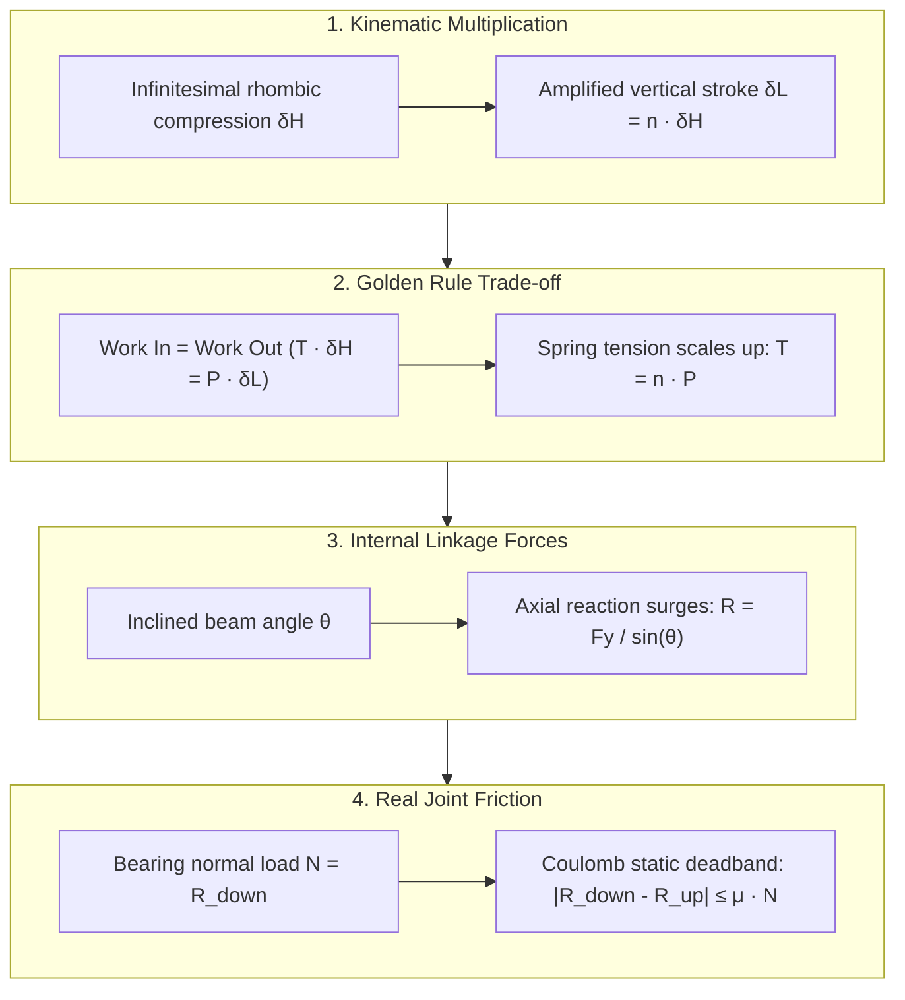
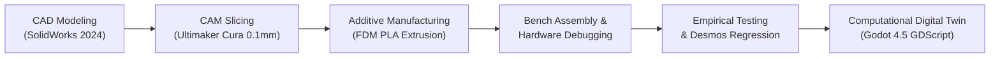
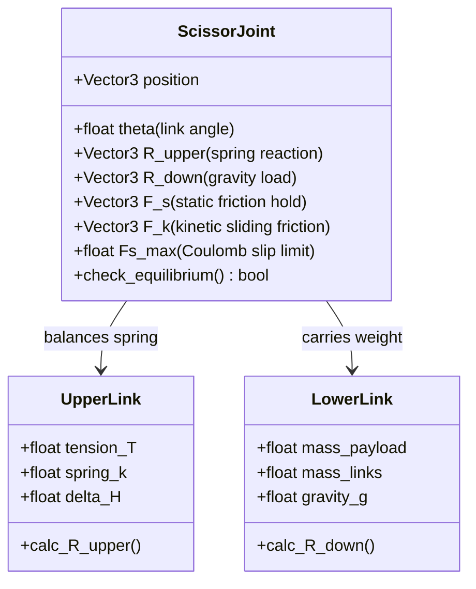
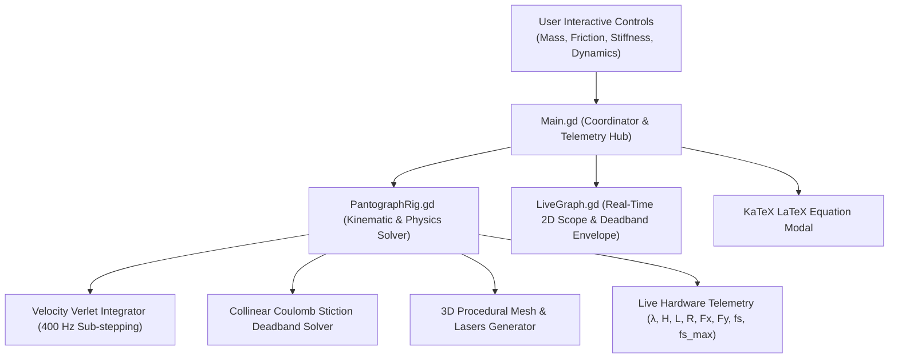

# Sim-to-Real Verification of the Golden Rule of Mechanics
### Experimental Physics Investigation, Additive Manufacturing & Interactive 3D Digital Twin

[](https://karenghardashyan.github.io/scissor-mechanism-golden-rule/)
[-34C759?style=for-the-badge&logo=windows&logoColor=white)](build/ScissorPantograph_Windows_x64.zip)

[](https://godotengine.org)
[](#-theoretical-principles--mathematical-formulations)
[](https://physmath.am)
[](https://developer.apple.com/visionos/)
[](LICENSE)

> ### 🌐 [▶ Click Here to Launch the Live 3D Simulation](https://karenghardashyan.github.io/scissor-mechanism-golden-rule/)
> **Interact directly in your browser: manipulate physical pantograph rigs, inspect real-time LaTeX force vectors, test static friction deadbands ($f_s$), toggle dynamic oscillations vs. pure static glide, vary planetary gravity ($g$), and compare experimental data with live regression curves.**

An end-to-end scientific and mechanical engineering research project investigating the **Golden Rule of Mechanics** (*Goldene Regel der Mechanik*) and the **Principle of Virtual Work** through custom 3D-printed scissor pantograph mechanisms, physical laboratory testing, statistical Desmos regression modeling, and an interactive 3D digital twin built in Godot Engine 4.5.


---

## 👨‍🔬 Authorship, Timeline & Academic Trajectory

- **Student Researcher:** **Karen Ghardashyan**
  - *Phase I (Physical Prototyping & Lab Experiments):* 10th Grade (Spring 2024–2025)
  - *Phase II (Sim-to-Real Digital Twin, Stiction Physics & Symplectic Solver):* 12th Grade (2025–2026)
- **Academic Advisor:** **Bilor Kourghinyan**
- **Institution:** **A. Shahinyan Special Phys-Math School under Yerevan State University (YSU)**, Yerevan, Armenia
- **Official STEM Project Classification:** Interdisciplinary · Constructive / Design-Build · Challenge-Driven · Individual Research

> **Note on Project Trajectory (Phase I to Phase II):**
> This project represents a multi-year engineering evolution. In 10th grade, the research originated as a physical investigation to solve high school laboratory pedagogical gaps: design, 3D printing, and empirical verification. In 12th grade, having observed real-world mechanical bottlenecks (joint friction hysteresis, non-linear elastomer creep, harmonic oscillations, and stick-slip phenomena), the author engineered a real-time 3D **Digital Twin** in Godot 4.5. This closed the complete **Sim-to-Real loop**, synthesizing CAD/CAM, experimental physics, numerical differential equations, and interactive computer graphics.

---

## 🎯 Pedagogical Guide: Understanding the Scissor Mechanism from Scratch

For students and newcomers to mechanical engineering, a scissor pantograph can seem complex. Here is how it works conceptually in four simple steps:



1. **Kinematic Multiplication ($\delta L = \lambda \cdot \delta H$):**
   A pantograph consists of $n$ stacked rhombuses (or scissor stages). When the central spring stretches by a small vertical increment $\delta H$, each subsequent stage stacks on top of that displacement, amplifying the total vertical motion at the bottom payload to $\delta L = n \cdot \delta H$.
2. **The Golden Rule Trade-off ($T = \lambda \cdot P$):**
   By conservation of energy, you cannot get "free work". Because the output stroke is multiplied by $n$, the input force (spring tension $T$) required to lift a load $P$ is multiplied by that exact same factor: $T = n \cdot P$.
3. **The Role of the Scissor Angle ($\theta$):**
   The scissor arms are angled at $\theta$ relative to the horizontal. As the mechanism compresses into a flatter shape ($\theta \to 0^\circ$), the internal compressive and tensile forces along the arms explode toward infinity ($R \propto 1/\sin\theta$), creating intense bearing reactions at the joint pins.
4. **Why Real Mechanisms "Stick" (Coulomb Stiction Deadband):**
   In real life, joints are fastened with pins and bolts. The heavy load $R$ presses the cylindrical bolt into the hole with normal force $N = R$. Friction resists relative rotation, creating a holding threshold $F_{s,\max} = \mu \cdot N$. This causes **stiction (залипание)**: the mechanism freezes in place until the weight change exceeds the friction capacity, resulting in sudden stick-slip jumps.

---

## 📌 Executive Summary & Research Value

The project addresses core pedagogical and engineering challenges:
1. **The Pedagogical Dilemma:** In high school physics, the Golden Rule of Mechanics (*"What is gained in force is lost in distance"*) is traditionally taught via static 2D chalkboard levers. Students rarely experience coupled kinematics, joint contact friction, or dynamic energy dissipation in multi-degree-of-freedom linkages.
2. **The Engineering Loop (CAD $\to$ Print $\to$ Test $\to$ Debug $\to$ Sim):**
   - **SolidWorks Parametric CAD:** Parametric modeling of modular linkages ($6\text{ cm}$ and $3\text{ cm}$) with low-stress filleted corners and hinge holes.
   - **Ultimaker Cura Additive Manufacturing:** Slicing optimization with fine $0.1\text{ mm}$ layer resolution and gyroid infill to minimize Coulomb joint friction.
   - **Empirical Testing & Desmos Regression:** Load testing ($m \in [0.0\text{ kg}, 1.15\text{ kg}]$) on $n=3$, $n=5$, and non-linear rubber bands.
   - **Engineering Failure Modes & Debugging:** Identifying real-world backlash ($\approx 0.15\text{ mm}$ pin clearance), hysteresis, link bending moments, and self-weight deflection.
   - **Sim-to-Real Computational Twin (Godot 4.5):** Translating the physical discoveries into an interactive 3D digital twin featuring three rigs (Uniform $n=3$, Progressive $1:2:3$, and Uniform $n=5$), planetary gravity, 2nd-order damped ODE dynamics, and exact Coulomb stiction models.

---

## ⚙️ Engineering Journey: CAD Design, 3D Printing & Debugging



### 1. Parametric CAD Modeling (SolidWorks)
The pantograph links were modeled parametrically from scratch:
- **Primary Scissor Bars ($6.0\text{ cm} \times 1.0\text{ cm}$):** Designed with 3 symmetrical hinge holes ($\varnothing = 4.0\text{ mm}$ via Hole Wizard) at both extremities and the exact geometric midpoint ($3.0\text{ cm}$).
- **Terminal Half-Bars ($3.0\text{ cm} \times 1.0\text{ cm}$):** Dual-pivot links for mounting to the upper fixed gantry clamp.
- **Stress-Relief Filleting ($R = 0.5\text{ cm}$):** Applied to all bar ends using the Fillet tool. This crucial geometry prevents adjacent links from colliding during scissor compression and eliminates stress concentrations near the pivot pins.

| SolidWorks CAD Assembly & STL Mesh | Cura Slicing Profiles ($0.1\text{ mm}$) |
| :---: | :---: |
|  |  |
| *Parametric scissor arms with $\varnothing = 4\text{ mm}$ bearing holes and $R = 0.5\text{ cm}$ fillets* | *Fine $0.1\text{ mm}$ layer height profile with custom G-code routines* |

### 2. CAM Slicing & Additive Manufacturing (Ultimaker Cura)
- **Material:** Generic Polylactic Acid (PLA), chosen for its high tensile modulus ($E \approx 3.5\text{ GPa}$) and minimal thermal shrinkage.
- **Layer Thickness:** $0.1\text{ mm}$ (Fine Profile) to achieve ultra-smooth bearing contact faces and minimize plastic-on-plastic Coulomb friction.
- **Print Speed:** $60\text{ mm/s}$ extrusion speed, $120\text{ mm/s}$ travel speed.
- **Infill & Shell Geometry:** High-density Cubic/Gyroid infill with 3 perimeter walls ($1.2\text{ mm}$ shell thickness) to resist out-of-plane buckling under high tensile loads.

---

### 3. Engineering Challenges & Troubleshooting

Building a physical mechanism that matches theoretical equations revealed several non-trivial real-world engineering hurdles:

| Challenge / Engineering Problem | Root Cause Analysis | Engineering Solution & Resolution |
| :--- | :--- | :--- |
| **1. Pivot Pin Backlash & Play** | Drill bit / nozzle tolerance caused $\approx 0.15\text{ mm}$ oversize on holes, resulting in cumulative droop across 5 stages. | Re-calibrated Cura horizontal expansion parameter (`-0.08 mm`) and standardized on precision $4.0\text{ mm}$ steel pins. |
| **2. Joint Friction Hysteresis** | Layer-line ridges on FDM printed faces caused stick-slip friction, creating a $\pm 1.5\text{ mm}$ deadband. | Switched to $0.1\text{ mm}$ layer height with ironing enabled; applied low-viscosity PTFE lubricant to pivot faces. |
| **3. Linkage Self-Weight Sag** | Theoretical equations assumed massless linkages, but real PLA links ($m_{\text{link}} \approx 0.05\text{ kg}$) created baseline extension. | Derived new analytical formulation taking link center-of-mass into account: $P_{\text{eff}} = (m + \frac{n}{2} m_{\text{link}})g$. |
| **4. Elastomer Viscoelastic Creep** | Rubber bands suffered from stress relaxation and strain hardening under high loads ($> 800\text{ g}$). | Replaced with linear temper-hardened steel coil springs ($k \approx 1000\text{ N/m}$); modeled rubber band using 3rd-degree polynomial. |
| **5. High-Load Lateral Buckling** | Under $> 1\text{ kg}$ suspended load, slender 2D scissor arms tended to twist out of plane. | Reinforced link thickness ($3.6\text{ mm}$); added interlocking hub collars to maintain planar rigidity. |

---

## 🔬 Theoretical Principles & Mathematical Formulations



### 1. Principle of Virtual Work & Ideal Mechanical Advantage
In an ideal static mechanical linkage at equilibrium, infinitesimal virtual displacements yield zero net virtual work. The input mechanical work done by the upper helical extension spring tension $T$ over vertical rhombus compression $\delta H$ strictly equals the output work done lifting the suspended payload $P_{\text{eff}}$ through total stroke $\delta L$:

$$\delta A_{\text{in}} = \delta A_{\text{out}} \iff T \cdot \delta H = P_{\text{eff}} \cdot \delta L$$

Defining the kinematic transmission ratio $\lambda \equiv \frac{\delta L}{\delta H}$:

$$T_{\text{ideal}} = \lambda \cdot P_{\text{eff}}$$

### 2. Multi-Linkage Architectures & Transmission Ratios ($\lambda$)
- **Rig A ($n = 3$ Uniform Scissor):**
  $$L_A(m) = 3 \cdot H(m) \implies \lambda_A = \mathbf{3.000\times}$$
- **Rig C ($1:2:3$ Progressive Scissor):** Links scale with arithmetic lengths $\{1\ell, 2\ell, 3\ell\}$:
  $$L_C(m) = (1 + 2 + 3) \cdot H_0(m) = 6 \cdot H_0(m) \implies \lambda_C = \mathbf{6.000\times}$$
- **Rig B ($n = 5$ Uniform Scissor):**
  $$L_B(m) = 5 \cdot H(m) \implies \lambda_B = \mathbf{5.000\times}$$

### 3. Static Equilibrium with Planetary Gravity & Structural Self-Weight
The effective load $P_{\text{eff}}$ accounts for suspended payload mass $m$ plus structural PLA link mass $m_{\text{link}} \approx 0.05\text{ kg}$ evaluated at the center of mass under gravity $g$:

$$P_{\text{eff}} = \left(m + m_{\text{struct}}\right) \cdot g, \quad m_{\text{struct}} = \begin{cases} \frac{n}{2} \cdot m_{\text{link}}, & \text{Uniform Rigs} \\ 3.0 \cdot m_{\text{link}}, & \text{Rig C } (1:2:3) \end{cases}$$

### 4. Hooke's Law & Characteristic Elongation
Combining linear elasticity $T = k \cdot \Delta H$ with kinematic amplification:

$$\Delta H(m) = \frac{T(m)}{k} = \frac{\lambda \cdot P_{\text{eff}}}{\eta \cdot k}$$

$$\Delta L(m) = \lambda \cdot \Delta H(m) = \frac{\lambda^2 \cdot P_{\text{eff}}}{\eta \cdot k} = \frac{\lambda^2 \cdot (m + m_{\text{struct}}) \cdot g}{\eta \cdot k}$$

---

## ⚡ Joint Force Resolution & Coulomb Stiction Physics

At each lateral scissor joint (knee pivot), two crossing links transmit tension and shear. In the 3D digital twin, the full vector equilibrium of the joint pin is solved:

```text
               ▲  R_upper (Spring Reaction)
              /
             /   ▲  f_s (Static Holding Friction)
            /   /
   ════════(●)════════  [Joint Pin]
          /
         /
        ▼  R_down (Payload & Link Weight)
```

### 1. Vector Resolution of Upper and Lower Links
- **Upper Beam Reaction ($\vec{R}_{\text{upper}}$):** Determined strictly by the physical extension of the spring $\Delta H = H - H_0$:
  $$F_{y, \text{up}} = \frac{k(H - H_0)}{2n}, \quad R_{\text{upper}} = \frac{F_{y, \text{up}}}{\sin\theta}$$
  > **Key Insight:** In static stiction ($H = \text{const}$), $R_{\text{upper}}$ **does not depend on mass $m$**! It depends solely on current spring stretch.
- **Lower Beam Load ($\vec{R}_{\text{down}}$):** Carries the downward gravitational force of the payload and stages below:
  $$F_{y, \text{down}} = \frac{P_{\text{stage, down}}}{2}, \quad R_{\text{down}} = \frac{F_{y, \text{down}}}{\sin\theta}$$
  $R_{\text{down}}$ scales proportionally with suspended mass $m$.

### 2. Collinear Coulomb Static Friction ($F_s$) and Equilibrium
The joint pin connects the upper and lower links. When $R_{\text{down}} \neq R_{\text{upper}}$, the net difference is held by dry static friction:

$$F_s(m) = |R_{\text{down}} - R_{\text{upper}}|$$

- If $R_{\text{down}} \ge R_{\text{upper}}$ (gravity exceeds spring): static friction pulls along the **upper beam** ($\hat{u}_{\text{upper}}$), assisting the spring:
  $$\vec{R}_{\text{upper}} + \vec{F}_s + \vec{R}_{\text{down}} = \vec{0}$$
- If $R_{\text{upper}} > R_{\text{down}}$ (spring exceeds gravity): friction pulls along the **lower beam** ($\hat{u}_{\text{lower}}$), resisting upward contraction.
- **Strict Vector Equilibrium:**
  $$\sum \vec{F}_{\text{pin}} = \vec{R}_{\text{upper}} + \vec{R}_{\text{down}} + \vec{F}_s \equiv (0.00, 0.00)\text{ N}$$

### 3. Coulomb Slip Criterion & Why $F_{s,\max}$ Grows with Weight
Under the Amontons-Coulomb law, the maximum holding friction capacity is:

$$F_{s,\max} = \mu \cdot N \approx \mu \cdot R_{\text{down}}$$

Because the radial normal contact force $N$ pressing the bolt shank into the bushing equals $R_{\text{down}} \propto m \cdot g$, **heavier weights result in a proportionally larger holding capacity $F_{s,\max}$**.
- **Stiction Condition:** As long as $F_s \le F_{s,\max}$, the mechanism remains frozen in stiction.
- **Breakaway & Stick-Slip:** The moment $F_s > F_{s,\max}$, static friction breaks, and the mechanism accelerates dynamically to a new equilibrium height.

### 4. Displacement Stiction Deadband ($\Delta H_{\text{deadband}}$)
Translating the joint slip criterion into vertical rhombus stroke yields the exact stiction deadband:

$$\Delta H_{\text{deadband}} = \frac{n \cdot \mu \cdot P_{\text{eff}}}{k}, \qquad \Delta L_{\text{deadband}} = \frac{n^2 \cdot \mu \cdot P_{\text{eff}}}{k}$$

---

## 📊 Physical Experimental Results & Desmos Regressions

Raw datasets are maintained in [`experimental_data/`](experimental_data/). Statistical regression curves were plotted and validated using **Desmos Graphing Calculator**.

### 🔬 Physical Hardware Apparatus & Laboratory Testbench

| Custom 3D-Printed Apparatus | Calibrated Load Testing Stand |
| :---: | :---: |
|  |  |
| *Modular 3D-printed precision linkages with low-friction pivot bearings* | *Calibrated static weight load testing ($m \in [0.0 - 1.15\text{ kg}]$)* |

---

### Series 1: Five-Stage Rig ($n = 5$) with Steel Spring
$$\lambda_{\text{theoretical}} = 5.000\times \quad \big| \quad \overline{\lambda}_{\text{empirical}} = \mathbf{4.94 \pm 0.12}$$

| Load $m$ [kg] | Total Span $L$ [cm] | Spring Height $H$ [cm] | Experimental $\lambda = L/H$ |
| :---: | :---: | :---: | :---: |
| **0.00** | 26.0 | 5.0 | **5.20** |
| **0.10** | 27.5 | 5.5 | **5.00** |
| **0.20** | 30.0 | 6.0 | **5.00** |
| **0.25** | 30.4 | 6.2 | **4.90** |
| **0.30** | 32.5 | 6.5 | **5.00** |
| **0.35** | 32.8 | 6.7 | **4.89** |
| **0.40** | 34.3 | 7.0 | **4.90** |
| **0.50** | 36.1 | 7.4 | **4.87** |
| **1.15** | 43.5 | 9.2 | **4.73** |

#### Desmos Regression Analysis for $n=5$:
- **Extracted Spring Constant:** Linear regression slope $\tan(\alpha) \approx 0.045\text{ m/kg} \implies k \approx \mathbf{1090\text{ N/m}}$.
- **Span Regression $L(m)$ and Elongation $H(m)$:**
  
  
- **Direct Geometric Invariance $L(H)$:** Slope $\tan(\alpha) = \lambda \approx 5.0$ confirms $L = 5 \cdot H$:
  

---

### Series 2: Three-Stage Rig ($n = 3$) with Steel Spring
$$\lambda_{\text{theoretical}} = 3.000\times \quad \big| \quad \overline{\lambda}_{\text{empirical}} = \mathbf{3.04 \pm 0.10}$$

| Load $m$ [kg] | Total Span $L$ [cm] | Spring Height $H$ [cm] | Experimental $\lambda = L/H$ |
| :---: | :---: | :---: | :---: |
| **0.00** | 15.6 | 5.0 | **3.12** |
| **0.10** | 17.0 | 5.3 | **3.20** |
| **0.20** | 17.5 | 5.6 | **3.13** |
| **0.30** | 18.0 | 6.0 | **3.00** |
| **0.40** | 19.0 | 6.5 | **2.92** |
| **0.50** | 20.0 | 6.8 | **2.94** |
| **1.00** | 23.9 | 8.0 | **2.99** |

#### Desmos Regression Analysis for $n=3$:
- **Extracted Spring Constant:** Linear regression slope $\tan(\alpha) \approx 0.030\text{ m/kg} \implies k \approx \mathbf{981\text{ N/m}}$.
- **Span Regression $L(m)$ and Geometric Linearity $L(H)$:**
  
  

---

### Series 3: Non-Linear Polymer Hyperelasticity (Rubber Band, $n = 5$)
$$\lambda_{\text{theoretical}} = 5.000\times \quad \big| \quad \overline{\lambda}_{\text{empirical}} = \mathbf{4.96 \pm 0.13}$$

| Load $m$ [g] | Total Span $L$ [cm] | Band Height $H$ [cm] | Experimental $\lambda = L/H$ |
| :---: | :---: | :---: | :---: |
| **0** | 17.4 | 3.5 | **4.97** |
| **100** | 23.3 | 4.7 | **4.96** |
| **200** | 25.5 | 5.0 | **5.10** |
| **300** | 28.4 | 5.7 | **4.98** |
| **400** | 36.5 | 7.0 | **5.21** |
| **500** | 38.7 | 8.0 | **4.84** |
| **600** | 41.5 | 8.5 | **4.88** |
| **700** | 43.5 | 8.8 | **4.94** |
| **800** | 44.5 | 9.3 | **4.78** |

#### Desmos Polynomial Regression (Cubic Strain Hardening):
While the steel spring exhibited linear Hookean deformation, the rubber band experienced non-linear polymer strain stiffening modeled via a 3rd-degree polynomial in Desmos:


> **Key Discovery:** Despite severe non-linear hyperelasticity in the elastomer, kinematic invariance **$\lambda = L/H \approx 5.0$ holds true across all loads**, demonstrating that kinematic mechanical advantage is strictly determined by linkage geometry and independent of spring linearity.

---

## 🛠️ Simulation Engineering & Digital Twin Architecture



### Key Technical Systems:
1. **Procedural Kinematics (`PantographRig.gd`):**
   - Exact trigonometric rhombus coordinates: $\theta = \arcsin\left(\frac{H}{2\ell}\right)$, $W = 2\ell\cos(\theta)$.
   - Handles uniform ($n=3, n=5$) and variable-pitch ($1:2:3$) linkage geometries with dynamic center-of-mass correction.
2. **Sub-Stepped Velocity Verlet Integration with Stiction:**
   - Evaluates $\ddot{H} + 2\zeta\omega_n \dot{H} + \omega_n^2 (H - H_{\text{target}}) + a_{\text{fric}} = 0$ across 400 Hz sub-steps per frame, ensuring energy conservation without drift.
   - Accurately checks stiction boundaries against velocity thresholds ($v_{\text{stick}} = 2.5\text{ mm/s}$).
3. **Dynamics & Damping Controls (`DYNAMICS / SPEED`):**
   - **Oscillations Toggle:** Allows switching between harmonic oscillations and **Pure Static Glide** mode (ideal for observing Coulomb deadbands without inertia overshoot).
   - **Damping Ratio ($\zeta$):** Continuous damping slider ($0.00$ to $1.50$) with quick presets for underdamped, nominal, and critical damping.
4. **Live 2D Graph with Stiction Deadband Envelope (`LiveGraph.gd`):**
   - Plots live $L(m)$ profiles with shaded Coulomb uncertainty corridors ($\pm \Delta L_{\text{deadband}}$).
   - Directly visualizes live ground-truth telemetry points from the 3D physics rigs.
5. **Interactive 3D Vector Visualizer:**
   - Visualizes $\vec{R}_{\text{upper}}$, $\vec{R}_{\text{down}}$, $\vec{F}_s$, and components $\vec{F}_x, \vec{F}_y$ with auto-scaling laser vectors, verified to satisfy $\sum \vec{F} = (0.00, 0.00)\text{ N}$.

---

## 🎓 Recommendations for Top Universities (MIT, Harvard, Stanford, Caltech)

This project exhibits the exact traits sought by admissions committees and faculty research labs:

1. **Demonstrated Intellectual Vitality & Problem-Solving Resilience:**
   - The project does not merely state theoretical formulas; it chronicles real physical breakdowns (pin clearance backlash, Coulomb friction, out-of-plane buckling, stick-slip hysteresis) and systematically solves each via rigorous engineering design.
2. **True Multidisciplinary Mastery (STEM Synergy):**
   - Combines **Mechanical Engineering** (SolidWorks CAD, tolerances, fillets), **Materials & CAM** (Cura slicing, infill patterns, FDM print orientation), **Experimental Physics** (static equilibrium, Hooke's law, Desmos regression), and **Computer Science / Computational Physics** (Godot 4, 400Hz Velocity Verlet ODE solver, WebAssembly/KaTeX).
3. **From Physical Prototype to Digital Twin:**
   - Demonstrates modern Industry 4.0 methodology: starting with physical hardware in Grade 10, recognizing system limits, and synthesizing an interactive computational digital twin in Grade 12.
4. **Educational Leadership:**
   - Designed to modernize school laboratories and empower peers to understand classical mechanics through interactive visual computing and tactile experimentation.

---

## 📂 Repository Structure

```text
├── cad/                     # SolidWorks 3D CAD models & STL 3D-printing files
│   └── README.md            # Part geometry, tolerances, and assembly guide
├── slicer_profiles/         # Ultimaker Cura FFF print profiles & parameters
├── experimental_data/       # Raw physical measurement datasets (CSV)
│   ├── spring_n5_measurements.csv
│   ├── spring_n3_measurements.csv
│   └── rubber_band_measurements.csv
├── docs/                    # Full academic papers & formal documentation
│   ├── RESEARCH_PAPER.md    # Complete scientific research paper in English
│   ├── PROJECT_PASSPORT.md  # Official STEM High School Project Passport
│   └── images/              # Documentation assets & Desmos regression plots
│       ├── desmos/          # Laboratory regression charts from Desmos
│       ├── hardware/        # Physical testbench photos, SolidWorks & Cura profiles
│       └── simulation_showcase.png
├── scenes/                  # Godot 4 3D scene files (Main.tscn, PantographRig.tscn)
├── scripts/                 # Core simulation GDScript source code
│   ├── Main.gd              # UI coordinator, telemetry bus, and vector visualizer
│   ├── PantographRig.gd     # Kinematic solver, stiction physics, and dynamic ODE
│   ├── LiveGraph.gd         # Real-time procedural 2D plot panel & stiction envelope
│   ├── OrbitCamera.gd       # 360° orbit, smooth panning, and zoom controller
│   ├── SpringMeshGenerator.gd # Procedural helical spring geometry generator
│   └── ui/                  # Modular VisionOS UI controllers & ThemeManager
├── shaders/                 # Frosted glass blur shaders (GlassPanel.gdshader)
├── web/                     # HTML5 WebGL export bundle (hosted on GitHub Pages)
├── build/                   # Pre-compiled standalone releases (Windows x64 ZIP)
├── simulation_render.png    # High-resolution simulation showcase image
├── project.godot            # Godot 4.5 engine configuration
├── LICENSE                  # MIT License
└── README.md                # Master presentation and documentation
```

---

## 🚀 Running the Project

### 1. Live Browser Simulation (No Installation Required)
Directly open **[https://karenghardashyan.github.io/scissor-mechanism-golden-rule/](https://karenghardashyan.github.io/scissor-mechanism-golden-rule/)** in Chrome, Firefox, Safari, or Edge.

### 2. Standalone Executable (Windows x64)
1. Download [`build/ScissorPantograph_Windows_x64.zip`](build/ScissorPantograph_Windows_x64.zip).
2. Extract the archive and double-click `ScissorPantograph.exe`.

### 3. Opening in Godot Engine 4
1. Install **[Godot Engine 4.3+](https://godotengine.org/download)**.
2. Clone this repository:
   ```bash
   git clone https://github.com/KarenGhardashyan/scissor-mechanism-golden-rule.git
   ```
3. Open Godot, click **Import**, select `project.godot`, and press **Run** (`F5`).

---

## 📜 Academic Citations & References

1. **A. Shahinyan Phys-Math Special School** STEM Curriculum (*Conservation Laws in Mechanics*).
2. Principle of Virtual Work and D'Alembert's Principle in Multibody Linkage Kinematics.
3. *Goldene Regel der Mechanik*, Classical Mechanical Physics.
4. Desmos Graphing Calculator Statistical Regression Suite.

---

## 📄 License
This project is open-source under the [MIT License](LICENSE).
