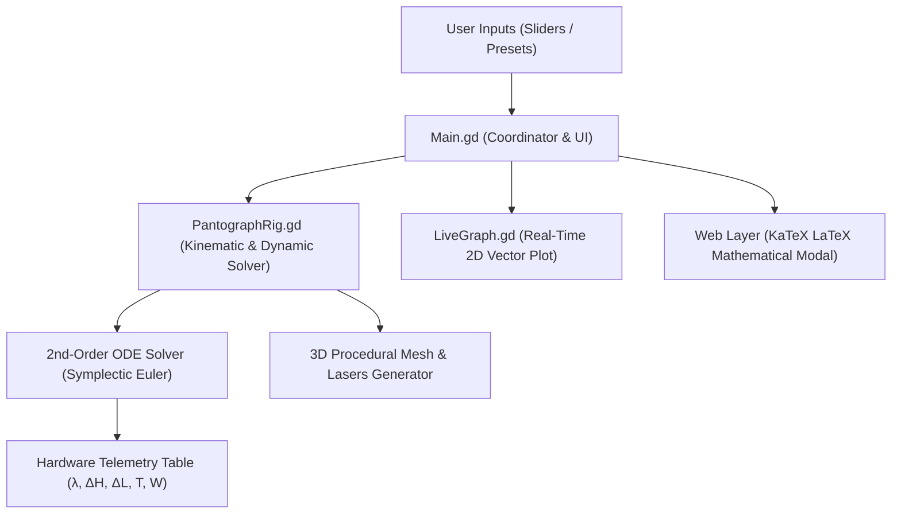

# Sim-to-Real Verification of the Golden Rule of Mechanics
### Experimental Physics Investigation, Additive Manufacturing & Interactive 3D Digital Twin

[](https://karenghardashyan.github.io/scissor-mechanism-golden-rule/)
[-34C759?style=for-the-badge&logo=windows&logoColor=white)](build/ScissorPantograph_Windows_x64.zip)

[](https://godotengine.org)
[](#-theoretical-principles--mathematical-formulations)
[](https://physmath.am)
[](https://developer.apple.com/visionos/)
[](LICENSE)

> ### 🌐 [▶ Click Here to Launch the Live 3D Simulation](https://karenghardashyan.github.io/scissor-mechanism-golden-rule/)
> **Interact with the physical rigs, inspect real-time LaTeX theory equations, adjust suspended masses ($m$), change spring constants ($k$), toggle mechanical efficiency ($\eta$), explore planetary gravity ($g$), and inspect regression curves directly in your web browser.**

An end-to-end scientific and engineering research project investigating the **Golden Rule of Mechanics** (*Goldene Regel der Mechanik*) and the **Principle of Virtual Work** through custom 3D-printed scissor pantograph mechanisms, physical laboratory testing, statistical Desmos regression modeling, and a real-time 3D simulation bench built in Godot Engine 4.


---

## 👨‍🔬 Authorship & Academic Affiliation

- **Student Researcher:** **Karen Ghardashyan** (10th Grade)
- **Academic Advisor:** **Bilor Kourghinyan**
- **Institution:** **A. Shahinyan Special Phys-Math School under Yerevan State University (YSU)**, Yerevan, Armenia
- **Academic Year:** 2024–2025 · Semester II

---

## 📌 Executive Summary

The project establishes a rigorous **Sim-to-Real loop** across three integrated engineering domains:
1. **Mechanical Design & Digital Fabrication (CAD/CAM):** Parametric SolidWorks modeling of modular scissor arms ($6\text{ cm}$ and $3\text{ cm}$) and precision 3D printing (Ultimaker Cura, $0.1\text{ mm}$ fine PLA) to minimize pivot friction. Includes both uniform pantographs ($n=3$, $n=5$) and a progressive variable-pitch pantograph with arm ratios **1:2:3**.
2. **Physical Load Testing & Desmos Statistical Regression:** Calibrated static load testing ($m \in [0.0\text{ kg}, 1.15\text{ kg}]$) on 3-stage ($n=3$) and 5-stage ($n=5$) testbenches using both Hookean steel springs and hyperelastic rubber polymers, analyzed via Desmos regressions ($R^2 > 0.99$).
3. **Interactive 3D Digital Twin & Simulation Architecture (Godot 4):** A real-time virtual testbench rendered in an Apple VisionOS *"Light Liquid Glass"* aesthetic, featuring:
   - **Rig A (Electric Blue):** Uniform 3-stage rhombus pantograph ($\lambda_A = 3.000\times$).
   - **Rig C (Emerald Green):** Progressive 1:2:3 variable-pitch pantograph ($\lambda_C = 6.000\times$).
   - **Rig B (Ultra Orange):** Uniform 5-stage rhombus pantograph ($\lambda_B = 5.000\times$).
   - **Interactive LaTeX Modal (KaTeX):** Full mathematical derivation window covering Virtual Work, joint friction dissipation, 2nd-order damped ODE dynamics, and celestial gravity.
   - **Planetary Gravity ($g$):** Real-time gravitational acceleration slider ($0.0 - 25.0\text{ m/s}^2$) with presets for Zero-G, Moon, Mars, Earth, and Jupiter.
   - **Harmonic Oscillations & Gliding:** Configurable 2nd-order spring-mass oscillator (damping ratio $\zeta \in [0.0, 0.6]$, circular frequency $\omega_n(k, m)$, dynamic impulse trigger).

---

## 🔬 Theoretical Principles & Mathematical Formulations

### 1. Principle of Virtual Work & Ideal Mechanical Advantage
In an ideal static mechanical linkage at equilibrium, infinitesimal virtual displacements yield zero net virtual work. The input mechanical work done by the upper helical extension spring tension $T$ over vertical rhombus compression $\delta H$ strictly equals the output work done lifting the suspended payload $P_{\text{eff}}$ through total stroke $\delta L$:

$$\delta A_{\text{in}} = \delta A_{\text{out}} \iff T \cdot \delta H = P_{\text{eff}} \cdot \delta L$$

Defining the kinematic transmission ratio $\lambda \equiv \frac{\delta L}{\delta H}$:

$$T_{\text{ideal}} = \lambda \cdot P_{\text{eff}}$$

### 2. Parasitic Energy Dissipation & Hinge Friction
In physical 3D-printed hardware, each scissor stage incorporates multiple rotating pivot pins. During angular rotation $\Delta \theta_i$, dry Coulomb friction and bearing contact resistance dissipate mechanical energy into irreversible thermal losses:

$$\Delta E_{\text{dissipated}} = \sum_{i=1}^{N_{\text{hinges}}} \int M_{\text{fric}, i}(\theta_i) \, d\theta_i$$

Where $M_{\text{fric}, i} = \mu \cdot R_i \cdot r_{\text{pin}}$ depends on joint reaction forces $R_i$, pin radius $r_{\text{pin}}$, and friction coefficient $\mu$. Taking transmission efficiency $\eta \in [0.50, 1.00]$ into account:

$$A_{\text{out}} = \eta \cdot A_{\text{in}} \iff T = \frac{\lambda \cdot P_{\text{eff}}}{\eta}$$

### 3. Multi-Linkage Architectures & Transmission Ratios ($\lambda$)
- **Rig A ($n = 3$ Uniform Scissor):**
  $$L_A(m) = 3 \cdot H(m) \implies \lambda_A = \mathbf{3.000\times}$$
- **Rig C ($1:2:3$ Progressive Scissor):** Links scale with arithmetic lengths $\{1\ell, 2\ell, 3\ell\}$:
  $$L_C(m) = (1 + 2 + 3) \cdot H_0(m) = 6 \cdot H_0(m) \implies \lambda_C = \mathbf{6.000\times}$$
- **Rig B ($n = 5$ Uniform Scissor):**
  $$L_B(m) = 5 \cdot H(m) \implies \lambda_B = \mathbf{5.000\times}$$

### 4. Static Equilibrium with Planetary Gravity & Structural Self-Weight
The effective load $P_{\text{eff}}$ accounts for suspended payload mass $m$ plus structural PLA link mass $m_{\text{link}} \approx 0.05\text{ kg}$ evaluated at the center of mass under gravity $g$:

$$P_{\text{eff}} = \left(m + m_{\text{struct}}\right) \cdot g, \quad m_{\text{struct}} = \begin{cases} \frac{n}{2} \cdot m_{\text{link}}, & \text{Uniform Rigs} \\ 3.0 \cdot m_{\text{link}}, & \text{Rig C } (1:2:3) \end{cases}$$

### 5. Hooke's Law & Characteristic Elongation
Combining linear elasticity $T = k \cdot \Delta H$ with kinematic amplification:

$$\Delta H(m) = \frac{T(m)}{k} = \frac{\lambda \cdot P_{\text{eff}}}{\eta \cdot k}$$

$$\Delta L(m) = \lambda \cdot \Delta H(m) = \frac{\lambda^2 \cdot P_{\text{eff}}}{\eta \cdot k} = \frac{\lambda^2 \cdot (m + m_{\text{struct}}) \cdot g}{\eta \cdot k}$$

### 6. Experimental Stiffness Extraction (Linear Regression Slope)
Differentiating $\Delta H$ with respect to suspended mass $m$ yields the experimental regression slope $\tan(\alpha)$:

$$\tan(\alpha) = \frac{\partial (\Delta H)}{\partial m} = \frac{\lambda \cdot g}{\eta \cdot k} \iff k = \frac{\lambda \cdot g}{\eta \cdot \tan(\alpha)}$$

### 7. 2nd-Order Dynamic Harmonic Vibration ODE
Transient response under step load transitions or dynamic impulses obeys the damped harmonic oscillator differential equation:

$$\frac{d^2 H}{dt^2} + 2 \zeta \omega_n \frac{dH}{dt} + \omega_n^2 \left(H(t) - H_{\text{target}}\right) = 0$$

Where natural frequency $\omega_n$ couples dynamically to spring stiffness $k$ and reflected mechanism inertia:

$$\omega_n = \sqrt{\frac{k_{\text{eff}}}{m_{\text{eff}}}} = \sqrt{\frac{k}{\frac{m + m_{\text{struct}}}{\lambda^2}}}, \qquad c = 2 \zeta \omega_n m_{\text{eff}}$$

---

## 📊 Physical Experimental Results & Desmos Regressions

Raw datasets are maintained in [`experimental_data/`](experimental_data/). Statistical regression curves were plotted and validated using **Desmos Graphing Calculator**.

### 🔬 Physical Hardware Apparatus & Laboratory Testbench
The physical validation experiments were conducted using custom 3D-printed pantograph linkages mounted on a calibrated vertical test stand with high-precision suspended masses and calibrated displacement sensors.

| Custom 3D-Printed Apparatus | Calibrated Load Testing Stand |
| :---: | :---: |
|  |  |
| *Modular 3D-printed precision linkages with low-friction pivot bearings* | *Calibrated static weight load testing ($m \in [0.0 - 1.15\text{ kg}]$)* |

> 📹 **Upcoming:** Full video demonstrations and high-speed motion capture recordings of physical vibration and dynamic testing will be linked here directly.

---

### Series 1: Five-Stage Rig ($n = 5$) with Steel Spring
$$\lambda_{\text{theoretical}} = 5.000\times \quad \big| \quad \overline{\lambda}_{\text{empirical}} = \mathbf{4.94 \pm 0.12}$$

| Load $m$ [kg] | Total Span $L$ [cm] | Spring Height $H$ [cm] | Experimental $\lambda = L/H$ |
| :---: | :---: | :---: | :---: |
| **0.00** | 26.0 | 5.0 | **5.20** |
| **0.10** | 27.5 | 5.5 | **5.00** |
| **0.20** | 30.0 | 6.0 | **5.00** |
| **0.25** | 30.4 | 6.2 | **4.90** |
| **0.30** | 32.5 | 6.5 | **5.00** |
| **0.35** | 32.8 | 6.7 | **4.89** |
| **0.40** | 34.3 | 7.0 | **4.90** |
| **0.50** | 36.1 | 7.4 | **4.87** |
| **1.15** | 43.5 | 9.2 | **4.73** |

#### Desmos Regression Analysis for $n=5$:
- **Extracted Spring Constant:** Linear regression slope $\tan(\alpha) \approx 0.045\text{ m/kg} \implies k \approx \mathbf{1090\text{ N/m}}$.
- **Span Regression $L(m)$ and Elongation $H(m)$:**
  
  
- **Direct Geometric Invariance $L(H)$:** Slope $\tan(\alpha) = \lambda \approx 5.0$ confirms $L = 5 \cdot H$:
  

---

### Series 2: Three-Stage Rig ($n = 3$) with Steel Spring
$$\lambda_{\text{theoretical}} = 3.000\times \quad \big| \quad \overline{\lambda}_{\text{empirical}} = \mathbf{3.04 \pm 0.10}$$

| Load $m$ [kg] | Total Span $L$ [cm] | Spring Height $H$ [cm] | Experimental $\lambda = L/H$ |
| :---: | :---: | :---: | :---: |
| **0.00** | 15.6 | 5.0 | **3.12** |
| **0.10** | 17.0 | 5.3 | **3.20** |
| **0.20** | 17.5 | 5.6 | **3.13** |
| **0.30** | 18.0 | 6.0 | **3.00** |
| **0.40** | 19.0 | 6.5 | **2.92** |
| **0.50** | 20.0 | 6.8 | **2.94** |
| **1.00** | 23.9 | 8.0 | **2.99** |

#### Desmos Regression Analysis for $n=3$:
- **Extracted Spring Constant:** Linear regression slope $\tan(\alpha) \approx 0.030\text{ m/kg} \implies k \approx \mathbf{981\text{ N/m}}$.
- **Span Regression $L(m)$ and Geometric Linearity $L(H)$:**
  
  

---

### Series 3: Non-Linear Polymer Hyperelasticity (Rubber Band, $n = 5$)
$$\lambda_{\text{theoretical}} = 5.000\times \quad \big| \quad \overline{\lambda}_{\text{empirical}} = \mathbf{4.96 \pm 0.13}$$

| Load $m$ [g] | Total Span $L$ [cm] | Band Height $H$ [cm] | Experimental $\lambda = L/H$ |
| :---: | :---: | :---: | :---: |
| **0** | 17.4 | 3.5 | **4.97** |
| **100** | 23.3 | 4.7 | **4.96** |
| **200** | 25.5 | 5.0 | **5.10** |
| **300** | 28.4 | 5.7 | **4.98** |
| **400** | 36.5 | 7.0 | **5.21** |
| **500** | 38.7 | 8.0 | **4.84** |
| **600** | 41.5 | 8.5 | **4.88** |
| **700** | 43.5 | 8.8 | **4.94** |
| **800** | 44.5 | 9.3 | **4.78** |

#### Desmos Polynomial Regression (Cubic Strain Hardening):
While the steel spring exhibited linear Hookean deformation, the rubber band experienced non-linear polymer strain stiffening modeled via a 3rd-degree polynomial in Desmos:


> **Key Discovery:** Despite severe non-linear hyperelasticity in the elastomer, kinematic invariance **$\lambda = L/H \approx 5.0$ holds true across all loads**, demonstrating that kinematic mechanical advantage is strictly determined by linkage geometry and independent of spring linearity.

---

## 🛠️ Simulation Engineering & Digital Twin Architecture

The 3D interactive workbench was designed from scratch in **Godot Engine 4 (GDScript)** to provide a 1:1 digital twin of the physical testbench:



### Key Technical Systems:
1. **Procedural Kinematics (`PantographRig.gd`):**
   - Calculates exact trigonometric rhombus positions: $\theta = \arccos\left(\frac{H}{2\ell}\right)$, $W = 2\ell\sin(\theta)$.
   - Handles both uniform and 1:2:3 progressive arm scaling with automatic center-of-mass balancing.
2. **Symplectic Integration for Dynamics:**
   - Evaluates $\ddot{H} + 2\zeta\omega_n \dot{H} + \omega_n^2 (H - H_{\text{target}}) = 0$ across 4 sub-steps per frame, ensuring numerical stability without jitter even at low damping ratios.
3. **Procedural Helical Spring Mesh (`SpringMeshGenerator.gd`):**
   - Generates 3D cylindrical tube coils along a 3D helix path in real time, flexing and compressing smoothly with dynamic load.
4. **Liquid Glass UI with KaTeX LaTeX Engine:**
   - VisionOS frosted glass aesthetic with floating panels, backdrop blur (`16px`), and web-integrated KaTeX typesetting for mathematical textbook formulas.

---

## 📂 Repository Structure

```text
├── cad/                     # SolidWorks 3D CAD models & STL 3D-printing files
│   └── README.md            # Part geometry, tolerances, and assembly guide
├── slicer_profiles/         # Ultimaker Cura FFF print profiles & parameters
├── experimental_data/       # Raw physical measurement datasets (CSV)
│   ├── spring_n5_measurements.csv
│   ├── spring_n3_measurements.csv
│   └── rubber_band_measurements.csv
├── docs/                    # Full academic papers & formal documentation
│   ├── RESEARCH_PAPER.md    # Complete scientific research paper in English
│   ├── PROJECT_PASSPORT.md  # Official STEM High School Project Passport
│   └── images/              # Documentation assets & Desmos regression plots
│       ├── desmos/          # Laboratory regression charts from Desmos
│       └── simulation_showcase.png
├── scenes/                  # Godot 4 3D scene files (Main.tscn, PantographRig.tscn)
├── scripts/                 # Core simulation GDScript source code
│   ├── Main.gd              # UI coordinator, telemetry bus, and KaTeX bridge
│   ├── PantographRig.gd     # Kinematic solver, spring dynamics, and lasers
│   ├── LiveGraph.gd         # Real-time procedural 2D plot panel
│   ├── OrbitCamera.gd       # 360° orbit, smooth panning, and zoom controller
│   └── SpringMeshGenerator.gd # Procedural helical spring geometry generator
├── shaders/                 # Frosted glass blur shaders (GlassPanel.gdshader)
├── web/                     # HTML5 WebGL export bundle (hosted on GitHub Pages)
├── build/                   # Pre-compiled standalone releases (Windows x64 ZIP)
├── simulation_render.png    # High-resolution simulation showcase image
├── project.godot            # Godot 4.5 engine configuration
├── LICENSE                  # MIT License
└── README.md                # Master presentation and documentation
```

---

## 🚀 Running the Project

### 1. Live Browser Simulation (No Installation Required)
Directly open **[https://karenghardashyan.github.io/scissor-mechanism-golden-rule/](https://karenghardashyan.github.io/scissor-mechanism-golden-rule/)** in Chrome, Firefox, Safari, or Edge.

### 2. Standalone Executable (Windows x64)
1. Download [`build/ScissorPantograph_Windows_x64.zip`](build/ScissorPantograph_Windows_x64.zip).
2. Extract the archive and double-click `ScissorPantograph.exe`.

### 3. Opening in Godot Engine 4
1. Install **[Godot Engine 4.3+](https://godotengine.org/download)**.
2. Clone this repository:
   ```bash
   git clone https://github.com/KarenGhardashyan/scissor-mechanism-golden-rule.git
   ```
3. Open Godot, click **Import**, select `project.godot`, and press **Run** (`F5`).

---

## 📜 Academic Citations & References

1. **A. Shahinyan Phys-Math Special School** STEM Curriculum (*Conservation Laws in Mechanics*).
2. Principle of Virtual Work and D'Alembert's Principle in Multibody Linkage Kinematics.
3. *Goldene Regel der Mechanik*, Classical Mechanical Physics.
4. Desmos Graphing Calculator Statistical Regression Suite.

---

## 📄 License
This project is open-source under the [MIT License](LICENSE).
