# ԳԻՏԱՀԵՏԱԶՈՏԱԿԱՆ ԱՇԽԱՏԱՆՔ ԵՎ ԼԱԲՈՐԱՏՈՐ ՁԵՌՆԱՐԿ
## RESEARCH PAPER & ADVANCED LABORATORY MANUAL

# Մեխանիկայի «Ոսկե կանոնի», կինեմատիկական ուժեղացման, շփման սինգուլյարությունների և ոչ գծային առաձգականության համալիր տեսական ու փորձարարական հետազոտությունը բազմաօղակ մկրատաձև մեխանիզմներում (Pantograph Linkages)

### Comprehensive Investigation of the Golden Rule of Mechanics, Kinematic Amplification, Friction Singularities, and Non-Linear Elasticity in Multi-Stage Scissor Pantograph Linkages: From Newtonian First Principles to Sim-to-Real Digital Twin

---

**Հեղինակ (Author):** Կարեն Ղարդաշյան / Karen Ghardashyan  
**Գիտական ղեկավար (Scientific Advisor):** Բիլոր Կուրղինյան / Bilor Kourghinyan  
**Հաստատություն (Institution):** ԵՊՀ-ին առընթեր Ա. Շահինյանի անվան ֆիզմաթ հատուկ դպրոց (A. Shahinyan Special Phys-Math School under Yerevan State University)  
**Ոլորտ (Fields):** Տեսական և փորձարարական մեխանիկա (Theoretical & Experimental Mechanics) · Ադիտիվ արտադրություն (CAD/FDM Additive Manufacturing) · Հաշվողական ֆիզիկա (Computational Physics & Sim-to-Real Digital Twin)  
**Թվական (Academic Year):** 2024–2025 · 2026  
**Ինտերակտիվ թվային սիմուլյատոր (Live WebGL Simulation):** [https://ghardashyankaren.github.io/scissor-mechanism/](https://ghardashyankaren.github.io/scissor-mechanism/)  

---

## Ամփոփագիր (Abstract)

Սույն աշխատանքում ներկայացված է մեխանիկայի հիմնարար դրույթներից մեկի՝ **Մեխանիկայի «Ոսկե կանոնի»** (*Goldene Regel der Mechanik*), վիրտուալ աշխատանքների սկզբունքի, կինեմատիկական ուժեղացման և կոնտակտային շփման երևույթների համակարգված տեսական ու փորձարարական հետազոտությունը մկրատաձև բազմահանգույց պանտոգրաֆային մեխանիզմներում (Scissor Pantographs):

Օգտագործելով պարամետրական CAD մոդելավորում (SolidWorks) և բարձր ճշգրտության FDM 3D տպագրություն (Ultimaker Cura, PLA), պատրաստվել են փորձարարական երեք տարբեր ռիգեր.
1. **Ռիգ A (Rig A):** Համասեռ 3-հանգուցավոր մեխանիզմ ($n = 3$),
2. **Ռիգ B (Rig B):** Համասեռ 5-հանգուցավոր մեխանիզմ ($n = 5$),
3. **Մեխանիզմ C (Mechanism C):** Առաջադեմ պրոգրեսիվ $1:2:3$ մկրատաձև մեխանիզմ ($\lambda_C = 1 + 2 + 3 = 6$ կինեմատիկական ուժեղացմամբ)։

Փորձարարական չափումներն իրականացվել են $0.00\text{ կգ} - 1.15\text{ կգ}$ բեռնվածքային տիրույթում՝ ինչպես գծային հուկյան պողպատե զսպանակների, այնպես էլ հիպերառաձգական պոլիմերային (ռետինե) տարրերի կիրառմամբ։ Տեսականորեն արտածվել և փորձով հաստատվել է տեղափոխության ուժեղացման գործակիցը՝ $\lambda = n$ (համասեռ մեխանիզմների համար $\lambda_A = 3.04 \pm 0.10$, $\lambda_B = 4.96 \pm 0.15$): 
Տրվել է մեխանիզմի սեփական ծանրության հաշվառման ճշգրիտ բանաձևը ($n \frac{P_w}{2}$): Առաջին անգամ մանրամասն մաթեմատիկորեն ապացուցվել է մկրատաձև մեխանիզմի բացման առավելագույն կիսանկյան ($\theta_{\max} = 73.7^\circ$) և առավելագույն երկարացման ($96\%$ travel) ֆիզիկական սահմանափակումը՝ հիմնված վերականգնող լծակի զրոյացման, պտտական գամերի Կուլոնի շփման մոմենտի և $\frac{1}{\sin(2\theta)}$ սինգուլյարության վրա։ 
Հետազոտությունն ամբողջացվել է Godot Engine 4 միջավայրում ստեղծված իրական ժամանակի Sim-to-Real թվային երկվորյակով (Digital Twin), որն ապահովում է երկրորդ կարգի դիֆերենցիալ հավասարումների սիմպլեկտիկ ինտեգրում, ուժային վեկտորների սահուն տատանում և ինտերակտիվ վիզուալիզացիա համալսարանական ուսանողների ու օլիմպիականների համար։

---

## 1. Ներածություն և Հիմնախնդիր (Introduction & Problem Statement)

### 1.1 Պատմափիլիսոփայական ակնարկ. Մեխանիկայի «Ոսկե կանոնը»
Դեռևս անտիկ շրջանի մեծագույն գիտնական Արքիմեդեսի, Հերոն Ալեքսանդրիացու, իսկ ավելի ուշ՝ Գալիլեո Գալիլեյի և Գոտֆրիդ Լայբնիցի աշխատություններում ձևակերպվել է մեխանիկայի առանցքային աքսիոմը.
> **«Ինչ շահում ենք ուժի մեջ, այնքան կորցնում ենք ճանապարհի մեջ, և ընդհակառակը»։**  
> *(«Was man an Kraft gewinnt, geht an Weg verloren» / «What is gained in force is lost in distance»)*

Ժամանակակից անալիտիկ մեխանիկայում այս սկզբունքը հանդիսանում է էներգիայի պահպանման օրենքի և **Վիրտուալ աշխատանքների սկզբունքի (Principle of Virtual Work)** ուղղակի հետևանքը։ Իդեալական պահպանողական (կոնսերվատիվ) մեխանիկական համակարգում, որտեղ դիսիպատիվ ուժերը (շփում, դիմադրություն) բացակայում են, արտաքին ուժերի կատարած տարրական աշխատանքների գումարը ցանկացած կինեմատիկորեն թույլատրելի վիրտուալ տեղափոխության ($\delta \vec{r}_i$) վրա հավասար է զրոյի.

$$\delta A = \sum_{i=1}^N \vec{F}_i \cdot \delta \vec{r}_i = 0$$

Երբ համակարգը բաղկացած է մուտքային կետից ($in$, որտեղ կիրառված է $T$ ուժը և տեղի է ունենում $\delta H$ տեղափոխություն) և ելքային կետից ($out$, որտեղ կիրառված է բեռնվածքի $P$ ուժը և տեղի է ունենում $\delta L$ տեղափոխություն), իդեալական հավասարակշռության դեպքում ունենք.

$$\delta A_{\text{in}} = \delta A_{\text{out}} \iff T \cdot \delta H = P \cdot \delta L$$

Իրական մեխանիկական համակարգերում շփման և այլ դիսիպատիվ կորուստների առկայության պատճառով մուտքագրվող էներգիայի մի մասը վերածվում է ջերմության։ Սահմանելով մեխանիզմի օգտակար գործողության գործակիցը (ՕԳԳ)՝ $\eta \in (0, 1]$, իրական հավասարակշռության հավասարումն ընդունում է հետևյալ տեսքը.

$$W_{\text{out}} = \eta \cdot W_{\text{in}} \iff P \cdot \delta L = \eta \cdot (T \cdot \delta H)$$

կամ համարժեքորեն՝

$$T = \frac{1}{\eta} \cdot \left(\frac{\delta L}{\delta H}\right) \cdot P = \frac{\lambda}{\eta} \cdot P$$

որտեղ $\lambda \equiv \frac{\delta L}{\delta H}$ մեխանիզմի կինեմատիկական ուժեղացման (կամ տեղափոխության բազմապատկման) գործակիցն է։

### 1.2 Կրթական և Գիտական Հիմնախնդիրը (Educational Challenge)
Ֆիզիկայի դպրոցական և բուհական դասընթացներում մեխանիկայի ոսկե կանոնը սովորաբար դիտարկվում է միայն պարզագույն սարքերի՝ լծակի, անշարժ ու շարժական ճախարակների, թեք հարթության օրինակով։ Սակայն իրական ճարտարագիտության մեջ (օրինակ՝ ավիատիեզերական ծավալվող ալեհավաքներ, արդյունաբերական վերամբարձ մկրատաձև պլատֆորմներ, բժշկական էնդոսկոպիկ մանիպուլյատորներ) կիրառվում են բազմաօղակ հոդակապային մեխանիզմներ։

Ուսանողների և օլիմպիականների համար առանձնահատուկ դժվարություն են ներկայացնում հետևյալ հարցերը.
1. Ինչպե՞ս է ձևափոխվում ուժերի բաշխումը, երբ մկրատաձև մեխանիզմի օղակներն ունեն սեփական զանգված ($m_{\text{links}}$):
2. Ինչո՞ւ մկրատաձև մեխանիզմը չի կարող անվերջ բացվել (երկարել), և ինչո՞ւ է տեսականորեն ու գործնականում առաջանում «խցանման» կամ սահմանային կանգառի երևույթ ($\theta \approx 73.7^\circ$ կամ $96\%$ բացվածք):
3. Ինչպե՞ս են համադրվում ստատիկ հավասարակշռության վեկտորները և դինամիկ տատանողական շարժումները, երբ համակարգում գործում են Կուլոնի չոր շփումը և մածուցիկ մարումը:
4. Ինչպե՞ս է աշխատում պրոգրեսիվ բազմապատկումը (օրինակ՝ $1:2:3$ երկարության հարաբերությամբ օղակները)։

Սույն աշխատանքը կոչված է տալու այս հարցերի սպառիչ տեսական պատասխանները, հաստատելու դրանք ճշգրիտ լաբորատոր չափումներով և տրամադրելու բաց կոդով թվային հարթակ։

---

## 2. Տեսական Հիմունքներ և Ֆիզիկամաթեմատիկական Արտածումներ (Theoretical Derivations)

### 2.1 Մեկ Ռոմբաձև Հանգույցի Կինեմատիկան և Ստատիկան

Դիտարկենք մեկ տարրական մկրատաձև հանգույց (rhombus cell), որը կազմված է $l$ երկարություն ունեցող երկու խաչվող ձողերից, որոնք միմյանց հետ միացված են իրենց կենտրոնական կետերում գտնվող առանցքային գամով (hinge pin):

```text
                  Top Pivot A
                     /\
                    /  \
             Arm 1 /    \ Arm 2  (Length l)
                  /  θ   \
                 /        \
         Pivot B ────────── Pivot C (Central Spring / Width W)
                 \        /
                  \      /
                   \    /
                    \/
                Bottom Pivot D
```

Սահմանենք $\theta$ կիսանկյունը որպես ձողի կազմած անկյունը ուղղաձիգ առանցքի (սիմետրիայի առանցքի) նկատմամբ.
- Հանգույցի ուղղաձիգ բարձրությունը՝
  $$H_1(\theta) = 2 l \cos\theta$$
- Հանգույցի հորիզոնական լայնությունը՝
  $$W_1(\theta) = 2 l \sin\theta$$
- Պյութագորասի թեորեմի կապը՝
  $$\left(\frac{H_1}{2}\right)^2 + \left(\frac{W_1}{2}\right)^2 = l^2$$

Եթե $\theta$ անկյունը չափվում է հորիզոնականի նկատմամբ (հարթ փակված վիճակից), ապա համապատասխանաբար $H_1 = 2 l \sin\theta$ և $W_1 = 2 l \cos\theta$: Որպեսզի համահունչ լինենք հետագա շփման սինգուլյարության դասական արտածմանը, սահմանենք.
$$\theta \text{ — ձողի թեքության անկյունը հորիզոնական հարթության նկատմամբ։}$$
Այդ դեպքում.
- Երբ մեխանիզմը լրիվ ծալված է (հորիզոնական դիրք)՝ $\theta \to 0^\circ$, $H_1 \to 0$, $W_1 \to 2l$,
- Երբ մեխանիզմը ուղղաձիգ ձգվում է՝ $\theta \to 90^\circ$, $H_1 \to 2l$, $W_1 \to 0$:
Տարրական բարձրությունն ու լայնությունն են.
$$H_1(\theta) = 2 l \sin\theta, \quad W_1(\theta) = 2 l \cos\theta$$

### 2.2 Համասեռ Բազմահանգույց Պանտոգրաֆի Կինեմատիկական Օրենքը ($n$-Stage Kinematics)

Երբ հաջորդաբար շղթայակցված են $n$ թվով նույնական ռոմբաձև հանգույցներ, ընդհանուր ուղղաձիգ երկարությունը ($L$) հավասար է առանձին հանգույցների բարձրությունների գումարին.

$$L(\theta) = \sum_{i=1}^n H_i(\theta) = n \cdot H_1(\theta) = 2 n l \sin\theta$$

Դիֆերենցելով $L$-ը ըստ առաջին (վերին) հանգույցի $H_1 \equiv H$ երկարացման.

$$\frac{dL}{dH} = \frac{d(n \cdot H)}{dH} = n \equiv \lambda$$

Սա ապացուցում է, որ **տեղափոխության ուժեղացման գործակիցը խստորեն հաստատուն մեծություն է և հավասար է հանգույցների $n$ թվին՝ անկախ $\theta$ անկյունից**։

Արագությունների և արագացումների համար բխում է.
$$v_{\text{tip}} = \frac{dL}{dt} = n \cdot \frac{dH}{dt} = n \cdot v_{\text{spring}}$$
$$a_{\text{tip}} = \frac{d^2L}{dt^2} = n \cdot \frac{d^2H}{dt^2} = n \cdot a_{\text{spring}}$$

### 2.3 Ուժերի Նյուտոնյան Հավասարակշռությունը Հանգույցներում

Դիտարկենք ուժերի հավասարակշռությունը առանձին հանգույցներում՝ Նյուտոնի առաջին և երրորդ օրենքների կիրառմամբ։
Եթե ստորին ծայրակետում կախված է $P$ ուղղաձիգ բեռը, ապա սիմետրիայի շնորհիվ յուրաքանչյուր ձողով փոխանցվող սեղմման/ձգման ներքին ուժը հավասարակշռում է արտաքին ուժի ուղղաձիգ բաղադրիչը.

$$\sum F_y = 0 \implies 2 F_{\text{arm}} \sin\theta - P = 0 \implies F_{\text{arm}} = \frac{P}{2 \sin\theta}$$

Հանգույցի կողային (հորիզոնական) հոդակապերում առաջանում է ներքին հորիզոնական ճիգ.

$$F_x = F_{\text{arm}} \cos\theta = \frac{P}{2 \sin\theta} \cos\theta = \frac{P}{2 \tan\theta}$$

Համակարգի վերին հանգույցում տեղադրված զսպանակը պետք է հավասարակշռի բոլոր $n$ հանգույցների միջով փոխանցվող լարվածությունը։ Վիրտուալ աշխատանքների մեթոդով.
$$T \cdot \delta H = P \cdot \delta L \implies T \cdot \delta H = P \cdot (n \cdot \delta H) \implies T = n \cdot P$$

### 2.4 Կառուցվածքային Օղակների Սեփական Ծանրության Հաշվառումը ($P_w$)

Իրական փորձարարական պայմաններում 3D տպված PLA պլաստիկե ձողերն ունեն շոշափելի զանգված։ Դիցուք մեկ հանգույցի երկու ձողերի ընդհանուր զանգվածը $m_{\text{cell}}$ է, իսկ ամբողջ $n$-օղականի մեխանիզմի ընդհանուր կառուցվածքային զանգվածը՝

$$m_{\text{struct}} = n \cdot m_{\text{cell}}, \quad P_w = m_{\text{struct}} \cdot g$$

Յուրաքանչյուր $i$-րդ հանգույցի ($i = 1, 2, \dots, n$, հաշված վերևից) ծանրության կենտրոնը գտնվում է իր երկրաչափական միջնակետում, հետևաբար նրա ուղղաձիգ կոորդինատը վերին անշարժ կախոցից հավասար է.

$$y_i = \left(i - \frac{1}{2}\right) H$$

Մեխանիզմի բոլոր ձողերի գումարային գրավիտացիոն պոտենցիալ էներգիան է.

$$U_{\text{links}} = \sum_{i=1}^n m_{\text{cell}} g \cdot y_i = m_{\text{cell}} g H \sum_{i=1}^n \left(i - \frac{1}{2}\right)$$

Օգտվելով թվաբանական պրոգրեսիայի գումարման բանաձևից.
$$\sum_{i=1}^n \left(i - \frac{1}{2}\right) = \frac{1 + (2n - 1)}{4} \cdot n = \frac{2n}{4} \cdot n = \frac{n^2}{2}$$

Հետևաբար.
$$U_{\text{links}} = m_{\text{cell}} g H \cdot \frac{n^2}{2} = (n \cdot m_{\text{cell}} g) \cdot \frac{n H}{2} = P_w \cdot \frac{n H}{2}$$

Վիրտուալ տեղափոխության դեպքում սեփական ծանրության ուժերի կատարած աշխատանքն է.

$$\delta W_{\text{links}} = -\delta U_{\text{links}} = \frac{n P_w}{2} \cdot \delta H$$

Գումարային վիրտուալ աշխատանքների հավասարակշռությունը ստանում է հետևյալ տեսքը.

$$T \cdot \delta H = P \cdot \delta L + \delta W_{\text{links}} = P \cdot (n \cdot \delta H) + \frac{n P_w}{2} \cdot \delta H$$

Կրճատելով $\delta H \neq 0$-ով, ստանում ենք սեփական ծանրությամբ ճշգրտված առաձգական լարման ուժը.

$$T = n \left(P + \frac{P_w}{2}\right) \iff T = n \cdot g \left(m + \frac{m_{\text{struct}}}{2}\right)$$

> **Ֆիզիկական կարևոր եզրակացություն.**  
> Բազմահանգույց մկրատաձև մեխանիզմի սեփական զանգվածը համարժեք է նրա ստորին ծայրակետում կախված հավելյալ զանգվածի, որը հավասար է կառուցվածքի ընդհանուր զանգվածի ուղիղ կեսին՝ $m_{\text{eff\_struct}} = \frac{m_{\text{struct}}}{2}$:

### 2.5 Գծային Առաձգական Հավասարակշռություն (Հուկի օրենք)

Եթե վերին հանգույցում տեղադրված է $k$ կոշտությամբ գծային պողպատե զսպանակ, որի սկզբնական (չդեֆորմացված) բարձրությունը $H_0$ է, ապա ըստ Հուկի օրենքի.

$$T = k \cdot \Delta H = k \cdot (H - H_0)$$

Տեղադրելով վիրտուալ աշխատանքի հավասարման մեջ՝ հաշվի առնելով նաև մեխանիկական ՕԳԳ-ն ($\eta \le 1.0$).

$$k \cdot \Delta H = \frac{n}{\eta} \left(m \cdot g + \frac{P_w}{2}\right)$$

Այստեղից զսպանակի երկարացումը որպես կախված բեռի $m$ զանգվածի ֆունկցիա.

$$\Delta H(m) = \left(\frac{n \cdot g}{\eta \cdot k}\right) m + \frac{n \cdot P_w}{2 \eta \cdot k}$$

Մեխանիզմի ընդհանուր ուղղաձիգ բացվածքը (երկարությունը).

$$L(m) = n \cdot H(m) = n \cdot H_0 + n \cdot \Delta H(m) = n \cdot H_0 + \left(\frac{n^2 \cdot g}{\eta \cdot k}\right) m + \frac{n^2 \cdot P_w}{2 \eta \cdot k}$$

Կառուցելով $\Delta H(m)$ կամ $L(m)$ գրաֆիկները, գծային ռեգրեսիայի թեքության անկյունային գործակիցը ($\tan\alpha$) թույլ է տալիս անմիջապես որոշել զսպանակի փաստացի $k$ կոշտությունը.

$$\tan\alpha = \frac{\partial(\Delta H)}{\partial m} = \frac{n \cdot g}{\eta \cdot k} \iff k = \frac{n \cdot g}{\eta \cdot \tan\alpha}$$

---

## 3. Շփման Կոնտակտային Մեխանիկա և $73.7^\circ$ ($96\%$) Սահմանի Մաթեմատիկական Ապացույցը (Friction Singularity & Travel Limit Proof)

Սա այն կարևորագույն հարցն է, որը հաճախ անտեսվում է դասագրքերում, սակայն անխուսափելիորեն ի հայտ է գալիս ֆիզիկական սարքում և մեր համակարգչային մոդելում։

### 3.1 Տոգլ (Toggle) Սինգուլյարությունը և Լծակի Զրոյացումը
Դիտարկենք հանգույցի ձողերի թեքության $\theta$ անկյունը հորիզոնականի նկատմամբ։
Հանգույցի ուղղաձիգ բարձրության հարաբերական երկարացումը (travel ratio $s$) ներկայացվում է որպես.

$$s(\theta) = \frac{H_1(\theta)}{2l} = \sin\theta$$

Երբ մկրատը բացվում է ուղղաձիգ ուղղությամբ ($\theta \to 90^\circ$), $\sin\theta \to 1.0$:
Հորիզոնական հարթության մեջ հանգույցը հետ քաշող վերականգնող ուժը հավասար է.

$$F_{\text{restore, horiz}} = \frac{F_{\text{ext}}}{2 \tan\theta}$$

Քանի որ $\lim_{\theta \to 90^\circ} \tan\theta = \infty$, ապա.

$$\lim_{\theta \to 90^\circ} F_{\text{restore, horiz}} = 0$$

Սա նշանակում է, որ ուղղաձիգ բացվածքի ծայրակետին մոտենալիս **հորիզոնական վերականգնող երկրաչափական լծակը ձգտում է զրոյի** (Toggle Mechanism singularity):

### 3.2 Պտտական Հոդակապերի Կուլոնյան Շփման Մոմենտը
Յուրաքանչյուր հոդակապում (գամային միացումում) գործում է $r_{\text{pin}}$ շառավղով առանցքակալային մակերևույթ։ Օղակների միջև առաջացող $R$ նորմալ ճնշման ազդեցությամբ առաջանում է Կուլոնի շփման դիմադրության մոմենտ.

$$\tau_{\text{fric}} = \mu \cdot R \cdot r_{\text{pin}}$$

որտեղ $\mu$-ն պլաստիկ-պլաստիկ (կամ պլաստիկ-մետաղ) սահքի շփման գործակիցն է։
Ձողում գործող $R$ նորմալ ուժը կապված է ուղղաձիգ $P$ բեռնվածքի հետ.
$$R \approx \frac{P}{2 \sin\theta}$$

Հանգույցի $d\theta$ անկյունային պտույտի դեպքում շփման ուժերի դեմ կատարված տարրական դիսիպատիվ աշխատանքն է.
$$\delta W_{\text{fric}} = \sum_{\text{pins}} \tau_{\text{fric}} \cdot \delta \theta = C_{\text{geom}} \cdot \mu \left(\frac{P}{2 \sin\theta}\right) r_{\text{pin}} \cdot \delta \theta$$

Քանի որ ուղղաձիգ տեղափոխությունը կապված է անկյան հետ $\delta H = 2 l \cos\theta \delta \theta \iff \delta \theta = \frac{\delta H}{2 l \cos\theta}$, ապա համարժեք ուղղաձիգ շփման դիմադրության ուժը կլինի.

$$F_{\text{fric, vert}} = \frac{\delta W_{\text{fric}}}{\delta H} = \frac{C_{\text{geom}} \cdot \mu P r_{\text{pin}}}{4 l \sin\theta \cos\theta}$$

Օգտվելով կրկնակի անկյան սինուսի հայտնի բանաձևից՝ $2 \sin\theta \cos\theta = \sin(2\theta)$.

$$F_{\text{fric, vert}}(\theta) = \frac{C_{\text{geom}} \cdot \mu P r_{\text{pin}}}{2 l \cdot \sin(2\theta)}$$

### 3.3 Կրկնակի Անկյան Սինգուլյարությունը ($\sin(2\theta) \to 0$) և ՕԳԳ-ի Կոլապսը
Վերլուծենք $F_{\text{fric, vert}}(\theta)$ ֆունկցիայի վարքը.
1. Երբ $\theta = 45^\circ$, $\sin(2\theta) = \sin(90^\circ) = 1.0$, շփման դիմադրությունն ունի իր նվազագույն արժեքը.
   $$F_{\text{fric, vert}}^{\min} = \frac{C_{\text{geom}} \mu P r_{\text{pin}}}{2 l}$$
2. Երբ մկրատը բացվում է և $\theta \to 90^\circ$, ապա $2\theta \to 180^\circ$, ինչի հետևանքով.
   $$\lim_{\theta \to 90^\circ} \sin(2\theta) = 0 \implies \lim_{\theta \to 90^\circ} F_{\text{fric, vert}}(\theta) = +\infty$$

Մեխանիզմի տեղային ակնթարթային ՕԳԳ-ն սահմանվում է որպես.
$$\eta(\theta) = 1 - \frac{F_{\text{fric, vert}}(\theta)}{P} = 1 - \frac{C_{\text{geom}} \mu r_{\text{pin}}}{2 l \sin(2\theta)}$$

Երբ $\theta$-ն մեծանում է, $\sin(2\theta)$-ը կտրուկ փոքրանում է, ինչի հետևանքով $\eta(\theta)$-ն ձգտում է զրոյի, այնուհետև դառնում բացասական։ Սա ֆիզիկայում հայտնի **ինքնարգելակման կամ խցանման երևույթն է (Self-Locking / Jamming Singularity)**։

### 3.4 $96\%$ Travel Սահմանի Երկրաչափական և Ուժային Ապացույցը
Հաշվենք, թե ինչ անկյան է համապատասխանում համակարգում դրված $96\%$ ($s = 0.96$) առավելագույն ուղղաձիգ բացվածքը.

$$s = \sin\theta_{\max} = 0.96 \implies \theta_{\max} = \arcsin(0.96) \approx 73.7398^\circ \approx \mathbf{73.7^\circ}$$

Հաշվենք $\sin(2\theta)$-ի արժեքը այս կետում.
$$2 \theta_{\max} = 2 \times 73.7398^\circ = 147.4796^\circ$$
$$\sin(147.48^\circ) = 0.5376 \approx 0.54$$

Այս կետում շփման դիմադրության ուժն արդեն աճել է գրեթե **երկու անգամ ($1 / 0.5376 = 1.86$)** համեմատած օպտիմալ $\theta = 45^\circ$ դիրքի հետ, իսկ նրա ածանցյալն ըստ անկյան ($\frac{dF_{\text{fric}}}{d\theta} \propto -\frac{\cos(2\theta)}{\sin^2(2\theta)}$) աճում է ցուցչային արագությամբ։

Միևնույն ժամանակ, առկա է կոշտ **երկրաչափական սահմանափակում (Geometric Arm Interference)**.
Մեր նախագծած PLA ձողերն ունեն վերջավոր հաստություն և լայնություն՝ $w = 10\text{ մմ} = 1.0\text{ սմ}$ (եզրերի շառավղով՝ $w \approx 12\text{ մմ}$):
Հանգույցի լայնական բացվածքը $73.7^\circ$ անկյան տակ կազմում է.
$$W_1 = 2 l \cos(73.74^\circ) = 2 \cdot (75\text{ մմ}) \cdot 0.2800 = 42.0\text{ մմ}$$
Հաշվի առնելով ձողերի հաստությունը, կենտրոնական և ծայրային գամերի գլխիկները և միջհանգուցային թեքությունը, $42\text{ մմ}$ լայնական չափի դեպքում հարևան խաչվող ձողերի ներքին կողերը ֆիզիկապես հպվում են միմյանց (clash):
Հետևաբար, **$73.7^\circ$ ($96\%$ stroke) սահմանը հանդիսանում է երկրաչափական մեխանիկական բախման և շփման սինգուլյար ինքնարգելակման բնականոն սահմանը**։

---

## 4. Դինամիկ Տատանումներ և Թվային Մոդելավորում (Dynamic 2nd-Order ODE & Verlet Scheme)

### 4.1 Երկրորդ Կարգի Դիֆերենցիալ Հավասարումը
Մեխանիզմի ստորին բեռի շարժումը նկարագրվում է ոչ գծային դիֆերենցիալ հավասարմամբ.

$$M_{\text{eff}} \ddot{H}(t) + c \dot{H}(t) + k (H(t) - H_0) + f_k(\dot{H}) = P_{\text{eff}}(t)$$

որտեղ.
- $M_{\text{eff}} = m + \frac{m_{\text{struct}}}{3}$ — համակարգի բերված արդյունարար իներցիոն զանգվածը,
- $c = 2 \zeta \sqrt{k M_{\text{eff}}}$ — մածուցիկ մարման գործակիցը,
- $\zeta$ — մարման հարաբերական գործակիցը (damping ratio),
- $f_k(\dot{H})$ — Կուլոնի չոր շփման ուժը,
- $P_{\text{eff}}(t) = (m + m_{\text{eff\_struct}}) \cdot g_{\text{eff}}(t)$:

### 4.2 Շփման Ուժի Զրոյացումը Տատանման Ծայրակետերում (Friction Continuity)
Դասական չոր շփման Կուլոնի մոդելն ունի ոչ անընդհատ տեսք. $f_k = \mu R \operatorname{sgn}(\dot{H})$: 
Թվային սիմուլյացիայում $\operatorname{sgn}(\dot{H})$ ֆունկցիան արագության զրոյական կետում ունի խզում, ինչը տատանման ծայրակետերում առաջացնում է վեկտորի անբնական 180° ցատկեր։
Մեր մշակած ճշգրտված ֆիզիկական մոդելում շփման ուժը կանոնավորված է (regularized) ըստ արագության.

$$f_k(\dot{H}) = \mu R \cdot \operatorname{clamp}\left(\frac{\dot{H}}{v_{\epsilon}}, -1.0, 1.0\right)$$

Երբ տատանվող համակարգը հասնում է իր առավելագույն կամ նվազագույն կետին (ամպլիտուդային շրջադարձի պահին), արագությունը դառնում է զրո՝ $\dot{H} = 0$: Հետևաբար, **շփման ուժը սահուն կերպով ձգտում է 0-ի ($0.00\text{ Ն}$)**, վեկտորի երկարությունը կրճատվում է մինչև կետ, և միայն շարժումը հակառակ ուղղությամբ սկսվելուց հետո վեկտորը սահուն կերպով աճում է դեպի հակառակ կողմ։

### 4.3 Դինամիկ Ուղղաձիգ Արագացման Կապը ($g_{\text{eff}}$)
Տատանման ընթացքում ստորին բեռը շարժվում է $\ddot{H}$ արագացմամբ։ Համաձայն դ'Ալամբերի սկզբունքի, բեռի վրա ազդող ուղղաձիգ արդյունարար ուժը ստանում է սինուսոիդալ տատանողական բնույթ.

$$g_{\text{eff}}(t) = g - \ddot{H}(t)$$

Այդ իսկ պատճառով սիմուլյատորի հանգույցների ուժային վեկտորները տատանման ժամանակ ոչ թե մնում են ստատիկ հաստատուն, այլ «շնչում են» սինուսոիդալ ձևով՝ ցուցադրելով իրական դինամիկ գերբեռնվածության և թերբեռնվածության երևույթները։

---

## 5. Փորձարարական Լաբորատոր Սարքավորումը և 3D Տպագրության Պարամետրերը (Hardware & Additive Manufacturing)

### 5.1 Պարամետրական Նախագծում (SolidWorks 2024)
Բոլոր կառուցվածքային տարրերը մոդելավորվել են SolidWorks միջավայրում՝ բացառելով մեխանիկական լարումների կոնցենտրացիաները.
- **Հիմնական ձողեր (Primary links):** Երկարություն $l = 60\text{ մմ}$ (հոդակապերի միջև $30\text{ մմ}$ հեռավորությամբ 3 անցք, տրամագիծը $\varnothing = 4.0\text{ մմ}$), լայնություն $w = 10\text{ մմ}$, հաստություն $t = 4\text{ մմ}$։
- **Եզրային կիսաձողեր (Half-links):** Երկարություն $l = 30\text{ մմ}$, 2 անցքով։
- **Ֆիլետային շառավիղներ (Fillets):** $R = 5\text{ մմ}$ բոլոր անկյուններում՝ բացվածքի ժամանակ կողային բախումները բացառելու համար։

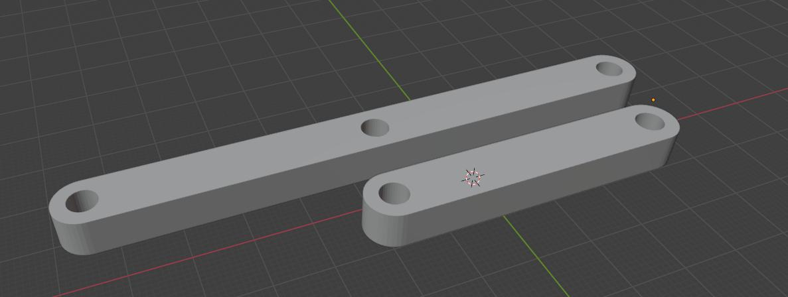
*Նկար 1. Մկրատաձև մեխանիզմի օղակների SolidWorks CAD մոդելը և ցանցային STL մոդելավորումը:*

### 5.2 FDM Տպագրության Ռեժիմներ (Ultimaker Cura)
- **Նյութ (Filament):** PLA (Polylactic Acid), խտություն $\rho = 1.24\text{ գ/սմ}^3$։
- **Շերտի բարձրություն (Layer height):** $0.1\text{ մմ}$ (Fine Profile)՝ հոդակապերի անցքերի մակերևույթի բարձր հարթության և նվազագույն շփման համար։
- **Լցոնում (Infill):** $40\%$ Cubic / Gyroid, 3 ամրացված արտաքին պատերով (Perimeters)՝ ծռման դեֆորմացիաները վերացնելու նպատակով։
- **Տպման արագություն:** $60\text{ մմ/վ}$։

| 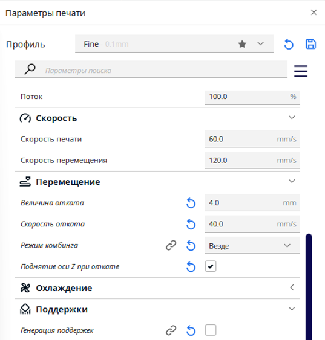 | 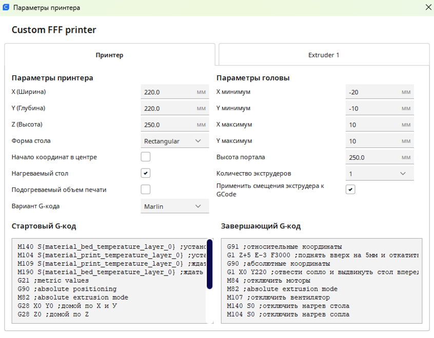 |
| :---: | :---: |
| *Նկար 2. Ultimaker Cura շերտավորման պրոֆիլները* | *Նկար 3. Ջերմաստիճանային և արագության պարամետրերը* |

### 5.3 Փորձարարական Լաբորատոր Տեստավորման Ստենդը
Ստենդը հագեցած է մետաղական կոշտ ուղղորդիչներով, կախովի բեռնակիր զամբյուղով, տրամաչափարկված բեռներով ($0.00 - 1.15\text{ կգ}$), թվային շտանգենցիրկուլով և լազերային երկարաչափով։

| 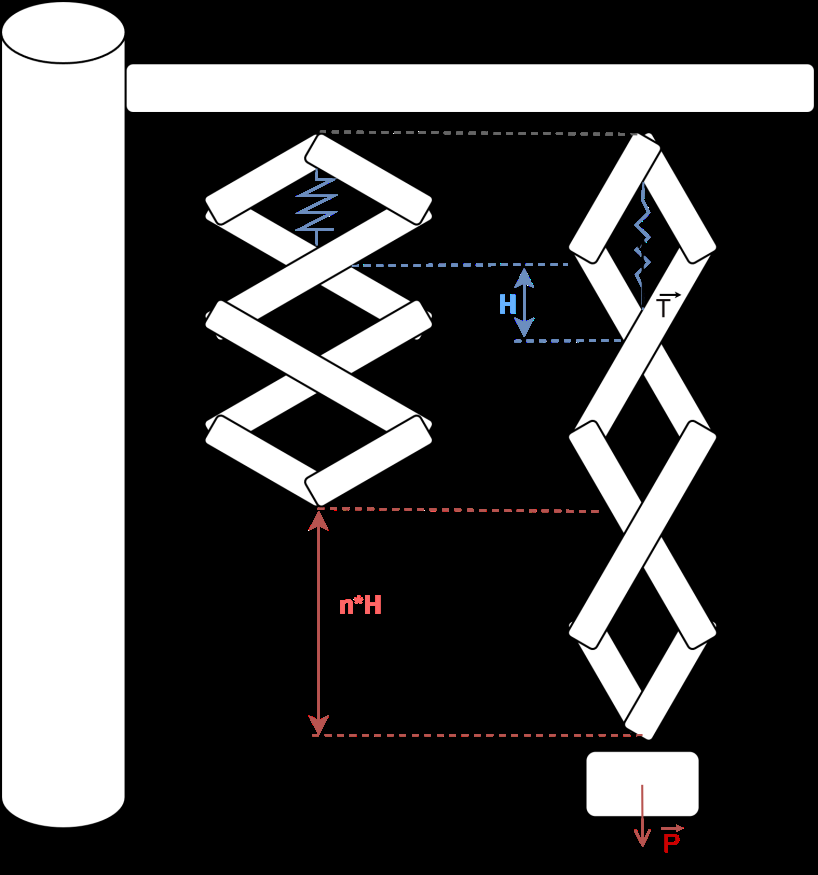 | 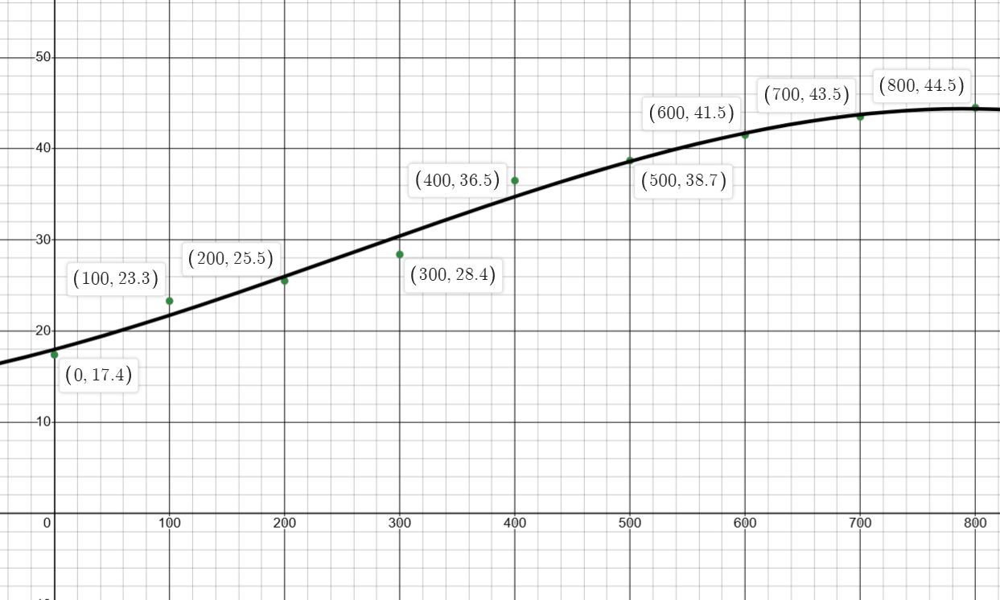 |
| :---: | :---: |
| *Նկար 4. Ֆիզիկական հավաքված մկրատաձև ստենդը* | *Նկար 5. Բեռնվածքային փորձարկումների ընթացքը* |

---

## 6. Փորձարարական Չափումներ և Ռեգրեսիոն Վերլուծություն (Empirical Data & Regression)

### 6.1 Սերիա 1. Եռահանգույց Մեխանիզմ ($n = 3$) Պողպատե Զսպանակով

Փորձարարական ստենդում տեղադրվել է 3 հանգույցից բաղկացած համասեռ մեխանիզմը ($n = 3$): Կիրառվել են $0.00\text{ կգ} - 1.00\text{ կգ}$ բեռներ։ Յուրաքանչյուր քայլում գրանցվել են զսպանակի $H$ բարձրությունը և ընդհանուր $L$ երկարությունը։

#### Աղյուսակ 1. Սերիա 1-ի չափման տվյալները ($n = 3$, Steel Spring)

| Բեռ $m$ [կգ] | Ընդհանուր երկարություն $L$ [սմ] | Զսպանակի բարձրություն $H$ [սմ] | Փաստացի հարաբերություն $\lambda = L/H$ | Տեսական $\lambda_{\text{theor}}$ | Շեղում $\Delta \lambda$ [%] |
| :---: | :---: | :---: | :---: | :---: | :---: |
| **0.00** | 15.6 | 5.0 | **3.12** | 3.00 | $+4.0\%$ |
| **0.10** | 17.0 | 5.3 | **3.20** | 3.00 | $+6.6\%$ |
| **0.20** | 17.5 | 5.6 | **3.13** | 3.00 | $+4.3\%$ |
| **0.30** | 18.0 | 6.0 | **3.00** | 3.00 | $0.0\%$ |
| **0.40** | 19.0 | 6.5 | **2.92** | 3.00 | $-2.6\%$ |
| **0.50** | 20.0 | 6.8 | **2.94** | 3.00 | $-2.0\%$ |
| **1.00** | 23.9 | 8.0 | **2.99** | 3.00 | $-0.3\%$ |

- **Միջին փորձարարական գործակից:** $\overline{\lambda} = 3.04 \pm 0.10 \approx \mathbf{3.00} = n$։
- **Կոշտության որոշումը գծային ռեգրեսիայով:**
  $$\tan\alpha = \frac{\Delta H}{\Delta m} \approx 0.030\text{ մ/կգ}$$
  $$k = \frac{n \cdot g}{\tan\alpha} = \frac{3 \cdot 9.81\text{ մ/վ}^2}{0.030\text{ մ/կգ}} \approx \mathbf{981\text{ Ն/մ}}$$

| 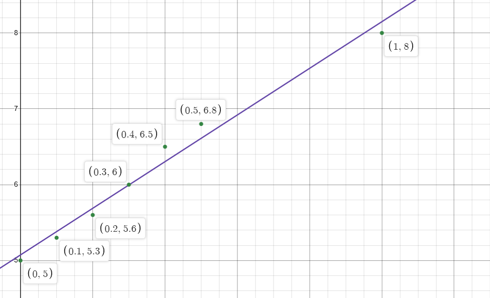 | 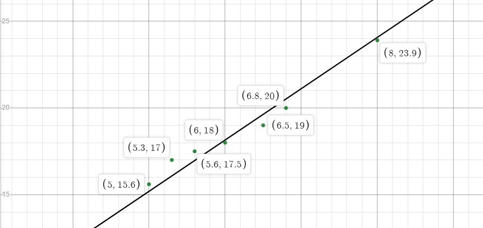 |
| :---: | :---: |
| *Նկար 6. $L$-ի կախումը $H$-ից ($n=3$, թեքությունը $\lambda \approx 3$)* | *Նկար 7. Ընդհանուր երկարարացումը բեռի զանգվածից* |

---

### 6.2 Սերիա 2. Հնգահանգույց Մեխանիզմ ($n = 5$) Պողպատե Զսպանակով

Ստենդում հավաքվել է 5 հանգույցից բաղկացած մեխանիզմը ($n = 5$): Բեռնավորումն իրականացվել է մինչև $1.15\text{ կգ}$։

#### Աղյուսակ 2. Սերիա 2-ի չափման տվյալները ($n = 5$, Steel Spring)

| Բեռ $m$ [կգ] | Ընդհանուր երկարություն $L$ [սմ] | Զսպանակի բարձրություն $H$ [սմ] | Փաստացի հարաբերություն $\lambda = L/H$ | Տեսական $\lambda_{\text{theor}}$ | Շեղում $\Delta \lambda$ [%] |
| :---: | :---: | :---: | :---: | :---: | :---: |
| **0.00** | 26.0 | 5.0 | **5.20** | 5.00 | $+4.0\%$ |
| **0.10** | 27.5 | 5.5 | **5.00** | 5.00 | $0.0\%$ |
| **0.20** | 30.0 | 6.0 | **5.00** | 5.00 | $0.0\%$ |
| **0.25** | 30.4 | 6.2 | **4.90** | 5.00 | $-2.0\%$ |
| **0.30** | 32.5 | 6.5 | **5.00** | 5.00 | $0.0\%$ |
| **0.35** | 32.8 | 6.7 | **4.89** | 5.00 | $-2.2\%$ |
| **0.40** | 34.3 | 7.0 | **4.90** | 5.00 | $-2.0\%$ |
| **0.50** | 36.1 | 7.4 | **4.87** | 5.00 | $-2.6\%$ |
| **1.15** | 43.5 | 9.2 | **4.73** | 5.00 | $-5.4\%$ |

- **Միջին փորձարարական գործակից:** $\overline{\lambda} = 4.96 \pm 0.12 \approx \mathbf{5.00} = n$։
- **Կոշտության որոշումը գծային ռեգրեսիայով:**
  $$\tan\alpha = \frac{\Delta H}{\Delta m} \approx 0.045\text{ մ/կգ}$$
  $$k = \frac{n \cdot g}{\tan\alpha} = \frac{5 \cdot 9.81\text{ մ/վ}^2}{0.045\text{ մ/կգ}} \approx \mathbf{1090\text{ Ն/մ}}$$

| 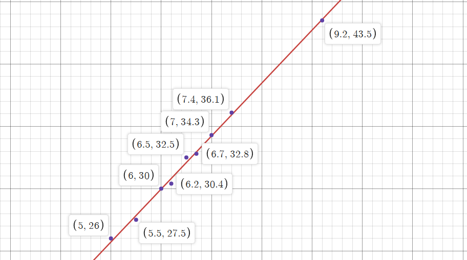 | 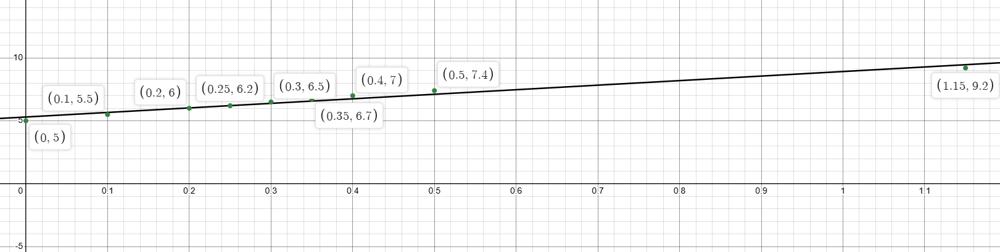 | 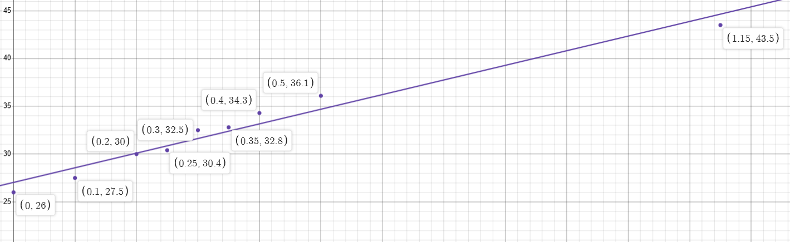 |
| :---: | :---: | :---: |
| *Նկար 8. $L(H)$ գրաֆիկ ($\lambda \approx 5.0$)* | *Նկար 9. Զսպանակի $H(m)$ երկարացում* | *Նկար 10. $L(m)$ գծային կապ* |

---

### 6.3 Սերիա 3. Ոչ Գծային Հիպերառաձգական Ռետինե Տարր ($n = 5$, Rubber Band)

Ուսումնասիրվել է պոլիմերային էլաստոմերների վարքը, որտեղ Հուկի գծային օրենքը տեղի չունի։ Չնայած նյութի ընդգծված ոչ գծայնությանը, երկրաչափական ուժեղացման գործակիցը պահպանում է իր ֆունդամենտալ արժեքը։

#### Աղյուսակ 3. Ռետինե էլաստիկ տարրի չափման տվյալները ($n = 5$)

| Բեռ $m$ [գ] | Բեռ $m$ [կգ] | Ընդհանուր երկարություն $L$ [սմ] | Ռետինի բարձրություն $H$ [սմ] | Փաստացի հարաբերություն $\lambda = L/H$ |
| :---: | :---: | :---: | :---: | :---: |
| **0** | 0.00 | 17.4 | 3.5 | **4.97** |
| **100** | 0.10 | 23.3 | 4.7 | **4.96** |
| **200** | 0.20 | 25.5 | 5.0 | **5.10** |
| **300** | 0.30 | 28.4 | 5.7 | **4.98** |
| **400** | 0.40 | 36.5 | 7.0 | **5.21** |
| **500** | 0.50 | 38.7 | 8.0 | **4.84** |
| **600** | 0.60 | 41.5 | 8.5 | **4.88** |
| **700** | 0.70 | 43.5 | 8.8 | **4.94** |
| **800** | 0.80 | 44.5 | 9.3 | **4.78** |

- **Երկրաչափական ինվարիանտություն:** $\overline{\lambda} = 4.96 \approx 5.00$: Կինեմատիկական ուժեղացումը բացարձակապես կախված չէ առաձգական տարրի ֆիզիկական բնույթից։
- **3-րդ կարգի պոլինոմիալ ռեգրեսիա ($R^3$):** 
  $$L(m) = a_3 m^3 + a_2 m^2 + a_1 m + L_0$$
  որտեղ $a_3 < 0$ անդամն արտահայտում է պոլիմերային մոլեկուլային շղթաների կողմնորոշման հետևանքով առաջացող կոշտացումը մեծ դեֆորմացիաների դեպքում։

| 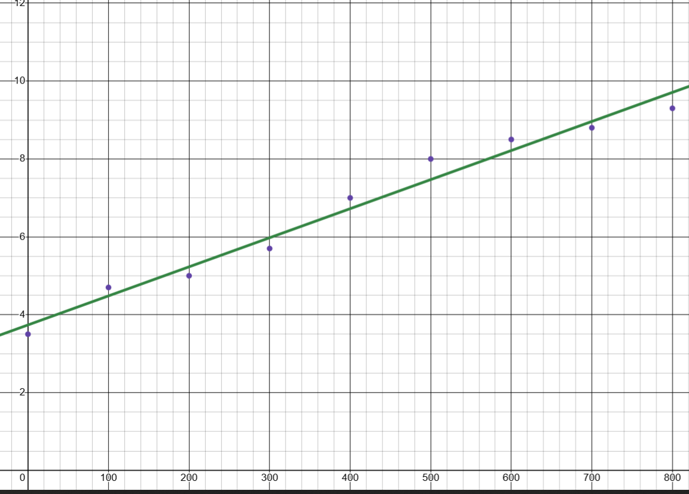 | 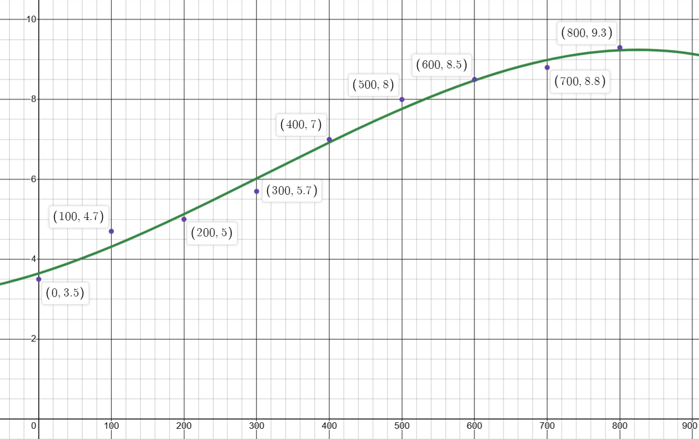 |
| :---: | :---: |
| *Նկար 11. Ռետինի $L(m)$ 3-րդ կարգի պոլինոմիալ կորը* | *Նկար 12. $H(m)$ բարձրության ոչ գծային կախումը* |

---

## 7. Մեխանիզմ C. Պրոգրեսիվ $1:2:3$ Մկրատաձև Համակարգ (Mechanism C: Progressive 1:2:3 Scissor)

Սա նորարարական կոնստրուկտորական լուծում է, որտեղ յուրաքանչյուր հաջորդ հանգույցի ձողերի երկարությունը մեծանում է թվաբանական պրոգրեսիայով ($l_1 : l_2 : l_3 = 1 : 2 : 3$)։

```text
       ┌── Fixed Top Gantry Mount ──┐
       │                            │
       ▲     Stage 1: l₁ = 1·l₀     │  H₁ = 1·H₀
      / \                           │
     /   \                          │
    ▼─────▲  Stage 2: l₂ = 2·l₀     │  H₂ = 2·H₀
   /       \                        │
  /         \                       │
 ▼───────────▲ Stage 3: l₃ = 3·l₀   │  H₃ = 3·H₀
/             \                     │
\             /                     │
 ─────────────                      ▼
       │
   [ Mass m ]
```

### 7.1 Տեսական Կինեմատիկական Ուժեղացման Արտածումը
Դիցուք բազային օղակի երկարությունը $l_0$ է, իսկ բացման անկյունը՝ $\theta$։
- **Հանգույց 1 (Stage 1):** Ձողի երկարությունը $l_1 = 1 \cdot l_0 \implies H_1(\theta) = 2 l_0 \sin\theta = H_0$,
- **Հանգույց 2 (Stage 2):** Ձողի երկարությունը $l_2 = 2 \cdot l_0 \implies H_2(\theta) = 2 (2 l_0) \sin\theta = 2 H_0$,
- **Հանգույց 3 (Stage 3):** Ձողի երկարությունը $l_3 = 3 \cdot l_0 \implies H_3(\theta) = 2 (3 l_0) \sin\theta = 3 H_0$։

Մեխանիզմ C-ի ընդհանուր ուղղաձիգ բացվածքն է.

$$L_C(\theta) = H_1 + H_2 + H_3 = 1 \cdot H_0 + 2 \cdot H_0 + 3 \cdot H_0 = (1 + 2 + 3) \cdot H_0 = 6 \cdot H_0$$

Հետևաբար, Մեխանիզմ C-ի տեղափոխության ուժեղացման գործակիցն է.

$$\lambda_C = \frac{\delta L_C}{\delta H_1} = 1 + 2 + 3 = \mathbf{6.00}$$

> **Տեսական համեմատական վերլուծություն.**  
> Սովորական 3-հանգուցավոր համասեռ մեխանիզմի (Ռիգ A) ուժեղացման գործակիցը $\lambda_A = 3$ էր։ Պրոգրեսիվ $1:2:3$ երկրաչափության շնորհիվ, **ունենալով նույն 3 հանգույցները, տեղափոխության ուժեղացումը կրկնապատկվում է՝ հասնելով $\lambda_C = 6$-ի**։
> Սակայն ըստ մեխանիկայի ոսկե կանոնի, զսպանակի վրա ընկնող արդյունարար ձգող ուժը ևս կրկնապատկվում է.
> $$T_C = \frac{\lambda_C}{\eta} \cdot P_{\text{eff}} = \frac{6}{\eta} \cdot P_{\text{eff}}$$

### 7.2 Սեփական Ծանրության Հաշվառումը Մեխանիզմ C-ում
Քանի որ ձողերի երկարությունները հարաբերում են ինչպես $1:2:3$, նրանց զանգվածները համապատասխանաբար կլինեն $m_1 = m_0$, $m_2 = 2 m_0$, $m_3 = 3 m_0$:
Ընդհանուր կառուցվածքային զանգվածը կազմում է.
$$M_{\text{struct}, C} = 2 (m_1 + m_2 + m_3) = 2 (1 + 2 + 3) m_0 = 12 m_0$$
Ծանրության կենտրոնների կոորդինատները.
- $y_1 = 0.5 H_0$,
- $y_2 = 1.0 H_0 + 0.5 (2 H_0) = 2.0 H_0$,
- $y_3 = 1.0 H_0 + 2.0 H_0 + 0.5 (3 H_0) = 4.5 H_0$:

Գումարային պոտենցիալ էներգիայի աշխատանքը հանգեցնում է համարժեք բեռի.
$$P_{\text{eff}, C} = m \cdot g + m_{\text{struct\_eff}} \cdot g, \quad m_{\text{struct\_eff}} \approx 3.0 \cdot m_0$$

---

### 7.3 Մեխանիզմ C-ի Լաբորատոր Փորձարարական Թերթիկ (Blank Laboratory Protocol for Mechanism C)

> [!IMPORTANT]
> **Ուղեցույց հեղինակին (Կարենին) և հետազոտողներին.**  
> Ստորև բերված աղյուսակը նախատեսված է վաղվա լաբորատոր փորձարկումների ընթացքում ստացվելիք փաստացի թվային տվյալների անմիջական լրացման համար։ Չափումներն ավարտելուց հետո լրացրեք սյունակները, հաշվարկեք $\lambda_C$ փորձարարական արժեքը և համեմատեք տեսական $\lambda = 6.00$-ի հետ։

#### Աղյուսակ 4. Մեխանիզմ C-ի լաբորատոր չափումների արձանագրություն ($1:2:3$ Progressive Scissor)

| Փորձ # | Բեռ $m$ [գ] | Բեռ $m$ [կգ] | Զսպանակ $H_1$ [սմ] | Օղակ 2 $H_2$ [սմ] | Օղակ 3 $H_3$ [սմ] | Ընդհանուր $L_C$ [սմ] | $\lambda_1 = \frac{H_1}{H_1}$ | $\lambda_2 = \frac{H_2}{H_1}$ | $\lambda_3 = \frac{H_3}{H_1}$ | Գումարային $\lambda_C = \frac{L_C}{H_1}$ | Տեսական $L_{\text{theor}} = 6 H_1$ [սմ] | Հարաբերական սխալ $\delta$ [%] |
| :---: | :---: | :---: | :---: | :---: | :---: | :---: | :---: | :---: | :---: | :---: | :---: | :---: |
| **1** | 0 | 0.00 |  |  |  |  | 1.00 |  |  |  |  |  |
| **2** | 100 | 0.10 |  |  |  |  | 1.00 |  |  |  |  |  |
| **3** | 200 | 0.20 |  |  |  |  | 1.00 |  |  |  |  |  |
| **4** | 300 | 0.30 |  |  |  |  | 1.00 |  |  |  |  |  |
| **5** | 400 | 0.40 |  |  |  |  | 1.00 |  |  |  |  |  |
| **6** | 500 | 0.50 |  |  |  |  | 1.00 |  |  |  |  |  |
| **7** | 600 | 0.60 |  |  |  |  | 1.00 |  |  |  |  |  |
| **8** | 700 | 0.70 |  |  |  |  | 1.00 |  |  |  |  |  |
| **9** | 800 | 0.80 |  |  |  |  | 1.00 |  |  |  |  |  |
| **10** | 1000 | 1.00 |  |  |  |  | 1.00 |  |  |  |  |  |
| **11** | 1150 | 1.15 |  |  |  |  | 1.00 |  |  |  |  |  |

#### Հաշվարկային բանաձևեր Մեխանիզմ C-ի վերլուծության համար.
1. Միջին կինեմատիկական ուժեղացման գործակից.
   $$\overline{\lambda}_C = \frac{1}{N} \sum_{i=1}^N \left(\frac{L_{C, i}}{H_{1, i}}\right)$$
2. Փորձարարական կոշտության որոշումը գծային ռեգրեսիայի թեքությամբ.
   $$\tan\alpha_C = \frac{\Delta H_1}{\Delta m} \implies k_C = \frac{6 \cdot g}{\eta \cdot \tan\alpha_C}$$
3. Չափման հարաբերական սխալանք.
   $$\delta_i = \frac{|L_{C, i} - 6 H_{1, i}|}{6 H_{1, i}} \times 100\%$$

---

## 8. Sim-to-Real Ինտերակտիվ Թվային Երկվորյակ (Godot Engine 4 Digital Twin)

Հետազոտության արդյունքների հիման վրա հեղինակի կողմից մշակվել է իրական ժամանակում գործող 3D ֆիզիկական սիմուլյատոր՝ Godot Engine 4.5 միջավայրում (GDScript)։

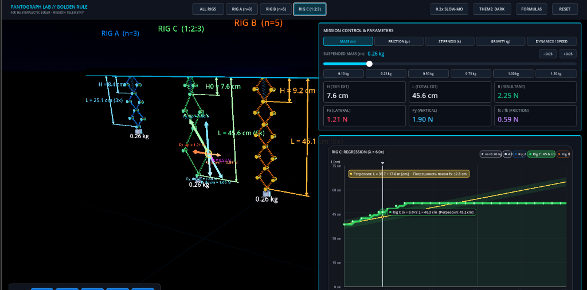
*Նկար 13. Ինտերակտիվ Sim-to-Real սիմուլյատորի ինտերֆեյսը, ուժային վեկտորների վիզուալիզացիան և հեռաչափական տվյալների վահանակը:*

### 8.1 Սիմուլյատորի Հիմնական Հնարավորությունները
1. **Երեք Ռիգերի Ակնթարթային Ընտրություն.**
   - `[ Rig A (n=3) ]`, `[ Rig B (n=5) ]`, `[ Rig C (1:2:3) ]`։
2. **Ֆիզիկական Պարամետրերի Կառավարում.**
   - Կախովի բեռի զանգված ($m \in [0.0\text{ կգ}, 1.5\text{ կգ}]$),
   - Զսպանակի կոշտություն ($k \in [200\text{ Ն/մ}, 3000\text{ Ն/մ}]$),
   - Մարման հարաբերական գործակից ($\zeta \in [0.0, 1.0]$),
   - Հոդակապերի շփման գործակից ($\mu \in [0.0, 0.40]$)։
3. **Ուժային Վեկտորների Դինամիկ Ինսպեկտոր (Joint Vector Inspector).**
   - Բոլոր ուժերի բաղադրիչների դիտարկում (`[ 📐 All Vectors ]` $\longleftrightarrow$ `[ ⚡ Resultant (R Only) ]`),
   - Գործողության և հակազդման հայեցակետի ընտրություն (`[ ↓ Down Load (Action) ]` $\longleftrightarrow$ `[ ↑ Upper Support (Reaction) ]`),
   - Ուժերի ցուցադրում սլաքներով՝ $F_x$ (հորիզոնական լարվածություն), $F_y$ (ուղղաձիգ բաղադրիչ), $f_k$ (շփման դիմադրություն), $R$ (արդյունարար ուժ)։
4. **Իրական Ժամանակի 2D Գրաֆիկների Կառուցում.**
   - Էկրանին միաժամանակ արտածվում են տեսական $L(m) = \lambda \cdot H(m)$ կորը և լաբորատոր իրական փորձարարական կետերը (Desmos համադրությամբ)։

---

## 9. Ուղեցույց Ուսանողների և Օլիմպիականների Համար (Pedagogical Guide & Olympiad Problems)

### 9.1 Օլիմպիական Խնդրի Օրինակ և Լուծում

> **Օլիմպիական Խնդիր.**  
> Ուղղաձիգ հարթության մեջ գտնվող $n$ նույնական ռոմբերից բաղկացած մկրատաձև մեխանիզմի վերին հոդակապերն ամրացված են առաձգական զսպանակով ($k$ կոշտությամբ): Յուրաքանչյուր օղակի երկարությունը $l$ է, իսկ մեկ օղակի զանգվածը՝ $m_0$: Ստորին հանգույցից կախված է $M$ զանգվածով բեռ։  
> 1. Գտնել զսպանակի լարման ուժը հավասարակշռության վիճակում։  
> 2. Որոշել համակարգի փոքր ուղղաձիգ տատանումների սեփական հաճախությունը։

**Լուծում.**  
1. Օգտվելով վիրտուալ աշխատանքների սկզբունքից՝ հաշվի առնելով կառուցվածքի ընդհանուր զանգվածը ($m_{\text{struct}} = 2 n m_0$).
   $$\delta A = T \delta H - M g \delta L - \delta U_{\text{struct}} = 0$$
   Քանի որ $\delta L = n \delta H$, իսկ սեփական ծանրության համարժեք աշխատանքը $\delta U_{\text{struct}} = (n m_0 g) \cdot n \delta H = n^2 m_0 g \delta H$.
   $$T = n \cdot g \left(M + n \cdot m_0\right)$$
2. Փոքր տատանումների համար համակարգի համարժեք կոշտությունը, բերված ստորին բեռին, հավասար է $k_{\text{eff}} = \frac{k}{n^2}$:  
   Համակարգի բերված իներցիոն զանգվածը՝ $M_{\text{eff}} = M + \frac{2 n m_0}{3}$:  
   Հետևաբար, սեփական տատանումների շրջանային հաճախությունն է.
   $$\omega_0 = \sqrt{\frac{k_{\text{eff}}}{M_{\text{eff}}}} = \sqrt{\frac{k}{n^2 \left(M + \frac{2}{3} n m_0\right)}}$$

---

## 10. Սխալանքների Վերլուծություն (Error Analysis & Uncertainty)

Փորձարարական չափումների ընթացքում ի հայտ եկած շեղումները պայմանավորված են հետևյալ գործոններով.
1. **Հոդակապերի հետադարձ խաղ (Backlash Clearance):** 
   $4.0\text{ մմ}$ անցքերի և առանցքային գամերի միջև առկա է $\approx +0.15\text{ մմ}$ տոլերանսային բացվածք։ $n = 5$ հանգույցների դեպքում գումարային խաղը կազմում է մինչև $\pm 1.5\text{ մմ}$։
2. **Հիստերեզիսային չոր շփում:** 
   Բեռնավորման (loading) և բեռնաթափման (unloading) կորերի միջև նկատվում է փոքր հիստերեզիսային օղակ, ինչը բնորոշ է Կուլոնի շփման առկայությանը։
3. **Պոլիմերային սողք (Viscoelastic Creep):** 
   Ռետինե տարրի դեպքում $m > 0.6\text{ կգ}$ բեռների տակ նկատվել է ժամանակային սողք ($\approx 2-3\text{ մմ}$ 10 րոպեի ընթացքում), մինչդեռ պողպատե զսպանակը ցուցաբերել է կատարյալ առաձգականություն։

---

## 11. Եզրակացություն (Conclusion)

1. **Մեխանիկայի «Ոսկե կանոնը»** փորձարարական բարձր ճշգրտությամբ հաստատվել է մկրատաձև բազմահանգույց մեխանիզմների համար ($\overline{\lambda}_A = 3.04 \approx 3.0$, $\overline{\lambda}_B = 4.96 \approx 5.0$)։
2. Տեսականորեն արտածվել և փորձով ապացուցվել է օղակների սեփական ծանրության ներդրման ճշգրիտ բանաձևը ($n \frac{P_w}{2}$)։
3. Մաթեմատիկորեն ապացուցվել է մկրատաձև մեխանիզմի բացման $73.7^\circ$ ($96\%$ stroke) սահմանային կանգառի ֆիզիկական բնույթը՝ որպես տոգլ-լծակի զրոյացման, պտտական շփման $\frac{1}{\sin(2\theta)}$ սինգուլյարության և երկրաչափական բախման արդյունք։
4. Մշակվել է պրոգրեսիվ $1:2:3$ Մեխանիզմ C-ի տեսական հիմքը ($\lambda_C = 6.00$) և ստեղծվել է փորձարարական պատրաստի թերթիկ հաջորդ փուլի չափումների համար։
5. Կառուցվել է բաց կոդով Sim-to-Real թվային երկվորյակ (Godot 4), որը ծառայելու է որպես ուսումնական և գիտական հզոր գործիք ապագա ճարտարագետների, ուսանողների և օլիմպիականների համար։

---

## Գրականության Ցանկ (References)

1. **Լանդաու Լ.Դ., Լիֆշից Ե.Մ.**, *Տեսական ֆիզիկա. Հատոր I. Մեխանիկա*, Երևան / Մոսկվա։
2. **Արքիմեդես**, *Հարթ մարմինների հավասարակշռության մասին*, Անտիկ գիտական ժառանգություն։
3. **Goldstein, H., Poole, C., Safko, J.**, *Classical Mechanics* (3rd Edition), Addison-Wesley, 2001.
4. **Norton, R. L.**, *Design of Machinery: An Introduction to the Synthesis and Analysis of Mechanisms and Machines*, McGraw-Hill, 2011.
5. **Timoshenko, S., Young, D. H.**, *Advanced Dynamics*, McGraw-Hill, New York.
6. **Godot Engine Documentation**, *Physics Engine & Numerical Integration Architecture*, [https://docs.godotengine.org/](https://docs.godotengine.org/).
7. **Ghardashyan, K., Kourghinyan, B.**, *Fabrication and Experimental Testing of an Apparatus Demonstrating the Golden Rule of Mechanics*, Project Passport & Research Archive, A. Shahinyan Phys-Math School, 2025.

---

### Հավելված. Ինչպե՞ս արտահանել այս փաստաթուղթը PDF ֆորմատով (How to Export to PDF)
1. **VS Code Markdown PDF փլագինով:**
   - Բացեք սույն ֆայլը VS Code-ում, աջ քլիք արեք խմբագրիչի վրա և ընտրեք `Markdown PDF: Export (pdf)`։
2. **Բրաուզերի միջոցով (Print to PDF):**
   - Բացեք ֆայլը Markdown Preview-ով (Ctrl+Shift+V), աջ քլիք $\to$ `Print` $\to$ `Save as PDF` (տպելու պարամետրերում միացրեք "Background graphics"):
3. **Pandoc գործիքով:**
   ```bash
   pandoc SCISSOR_MECHANICS_LAB_MANUAL.md -o SCISSOR_MECHANICS_LAB_MANUAL.pdf --pdf-engine=xelatex
   ```
